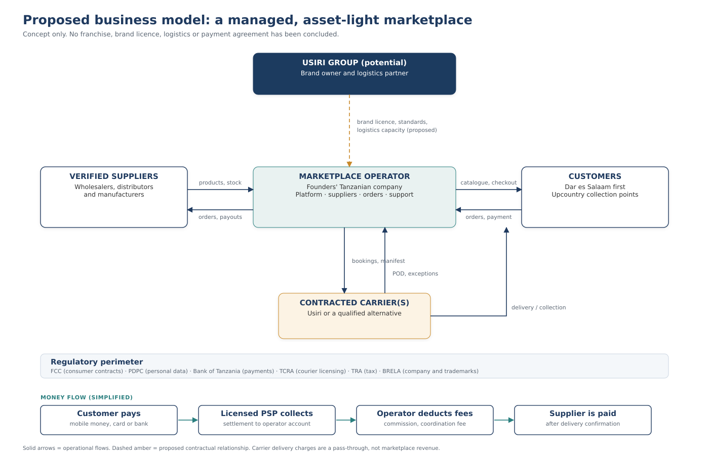
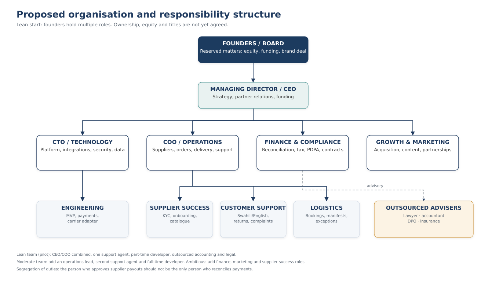
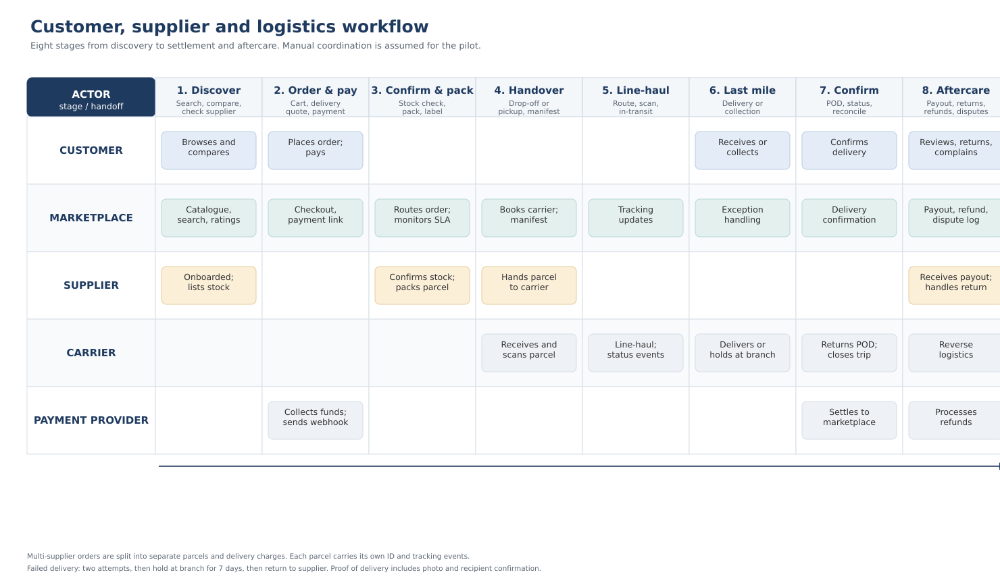
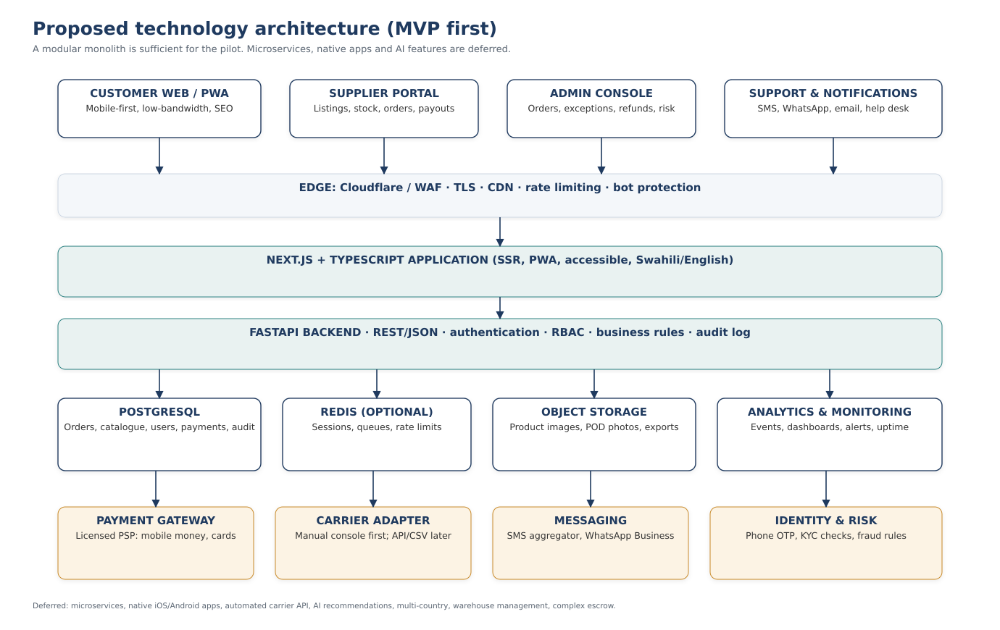

# Usiri Marketplace

## A proposed multi-vendor e-commerce and coordinated-delivery platform for Tanzania

**Working name only — no Usiri affiliation is implied.**

**Project concept document for internal discussion**

| Document control | |
|---|---|
| Version | 1.0 — for group discussion |
| Date | 29 October 2026 |
| Prepared for | The founding group |
| Prepared by | Project initiator |
| Status | **Concept under investigation.** Not an approved project. Not a Usiri project. No partnership, franchise, licence, funding or technical integration exists. |
| Decision sought | Whether to fund a defined research phase (Phase 2), revise the concept, or stop |

---

> **Important notice — please read before the rest of the document**
>
> This document explores a business idea. It is not a business plan, a legal opinion, a tax opinion, an offer, a prospectus, or a commitment by anyone.
>
> **No relationship with Usiri Group of Companies exists.** Usiri is named only as one possible logistics and brand partner that the group could approach for discussions. Nothing in this document has been approved, authorised, sponsored or reviewed by Usiri. No franchise fee, royalty, route rate, service level, API, data-sharing arrangement or brand licence has been agreed, quoted or confirmed.
>
> **All financial figures are planning assumptions**, expressed in Tanzanian shillings (TZS). They are not quotations, market prices or forecasts. Supplier commissions, payment fees, delivery charges, salaries and the hypothetical franchise fee must all be tested with real counterparties.
>
> **Market figures are directional.** Public estimates of Tanzania's e-commerce market disagree with each other. They are used here to describe scale and uncertainty, not to promise a revenue opportunity.
>
> **No regulatory approval has been obtained.** References to Tanzania's data protection, consumer protection, payment, tax and transport rules are a map of questions for professional advisers, not a compliance certificate.
>
> The names and marks of Usiri and other companies belong to their owners. This document does not grant any right to use them.
>
> Anyone committing money, signing an agreement or approaching a partner should verify the relevant facts independently.

---

## How to read this document

The document is written for a group of university students and early-career entrepreneurs. It assumes curiosity but not specialist knowledge. Technical, legal and financial terms are explained the first time they appear, and there is a glossary at the end.

Each factual statement is tagged so that readers can see how much weight it can bear:

| Tag | Meaning |
|---|---|
| **[Verified]** | Checked against an official or primary source that is listed in Appendix B. |
| **[Self-reported]** | A claim made by a company about itself. It may be true, but it has not been independently audited. |
| **[Estimate]** | A third-party estimate or model. Useful for direction, not precision. |
| **[Assumption]** | A number or belief the group is using for planning. It must be tested. |
| **[To verify]** | A question on which the group does not yet have enough evidence. |

Source codes such as [S5] refer to the source register in Appendix B. Where sources conflict, the conflict is shown rather than hidden. The document also states, in Appendix F, what evidence would prove it wrong. A concept document that cannot be falsified is marketing, not analysis.

The document follows the twenty sections requested by the group's brief. Sections 1–5 explain the idea and the proposed partner relationship. Sections 6–12 explain how it would work. Sections 13–18 test whether it is feasible. Sections 19–20 set out the decision the group must make. The appendices hold the assumptions, sources, research checklist and glossary.

---

## Glossary of key terms

**Asset-light.** A business that does not own most of the expensive physical assets it uses. A marketplace can own software and contracts while suppliers own stock and carriers own vehicles.

**Average order value (AOV).** Total value of goods sold divided by the number of orders. If ten orders are worth TZS 750,000 together, the AOV is TZS 75,000.

**Break-even.** The sales volume at which contribution equals fixed costs, so the business makes neither a profit nor a loss.

**Carrier / 3PL.** A transport company that moves parcels. "Third-party logistics" (3PL) means using an outside company rather than owning a fleet.

**Chargeback.** A card payment that a customer disputes through the bank and has reversed. The platform may have to repay the money even after the goods have gone.

**Commission (take rate).** The percentage of a sale that the marketplace keeps. If a TZS 100,000 sale carries an 8% commission, the platform earns TZS 8,000 before payment and delivery costs.

**Contribution.** Revenue from an order minus the costs that vary directly with that order (payment fees, support, refund handling, delivery cost). Contribution is the money available to pay fixed costs. It is not profit.

**Escrow.** A legal arrangement in which a neutral, licensed party holds a buyer's money until conditions are met. Calling an ordinary platform wallet "escrow" does not make it one.

**Franchise.** A licence to operate a business under another company's brand and system, usually for an initial fee plus continuing royalties. Tanzania has no stand-alone franchise statute; franchise relationships are governed mainly by contract and trademark law [S13].

**Gross merchandise value (GMV).** The total value of goods sold through the platform, including the supplier's share. GMV is not the platform's revenue.

**KYC (know your customer).** Checks on the identity and legitimacy of a supplier or customer before doing business.

**MVP (minimum viable product).** The smallest version of a product that can be used by real customers to complete a real job, built to test assumptions rather than to impress.

**PDPA.** Tanzania's Personal Data Protection Act, 2022. It sets rules for collecting and using personal data and creates the Personal Data Protection Commission (PDPC) [S14].

**PSP (payment service provider).** A licensed company that processes payments. In Tanzania, payment services are regulated by the Bank of Tanzania.

**Reconciliation.** The routine matching of what the platform's order records say, what the payment provider actually settled, and what was paid out to suppliers. Poor reconciliation is how marketplaces lose money quietly.

**RACI.** A responsibility chart: who is **R**esponsible for doing the work, who is **A**ccountable for the result, who must be **C**onsulted, and who is **I**nformed.

**SLA (service level agreement).** A written promise about performance, such as delivery within 48 hours or response to a complaint within one working day, with consequences if it is missed.

**Take rate.** See commission. It can be calculated on gross sales or on net sales after returns; this document is explicit about which one is used.

---

# 1. Executive summary

## 1.1 The idea

The group is exploring a curated, multi-vendor online marketplace for Tanzania, operating initially in Dar es Salaam. Independent verified shops would list their products; the platform would bring customers, collect payment, coordinate delivery through a licensed carrier, handle customer service and stand behind the transaction when something goes wrong.

The proposed launch assortment is **everyday home, kitchen and small electrical goods** in the TZS 30,000–250,000 price band, sold by 25–40 verified Dar es Salaam suppliers. This is narrower than "sell everything". The narrowness is deliberate: it keeps delivery manageable, reduces counterfeit and warranty risk, and lets a small team become genuinely good at one promise before expanding.

The business would be **asset-light**. It would not buy stock, own warehouses or run its own fleet at pilot stage. It would earn a commission on sales, a small supplier subscription, a delivery coordination fee and, later, sponsored placement. Suppliers would hold stock and pack orders. A licensed carrier would move parcels. A licensed payment provider would collect money.

Usiri Group of Companies is one possible partner for the delivery and brand layer. **It is not a partner today.** The group has not approached Usiri for this project, has no term sheet, and has no confirmation that Usiri offers an API, a franchise, a rate card or any willingness to support a marketplace. The pilot plan is designed so that it can proceed with an independent brand and at least two carriers if Usiri declines or negotiations stall.

## 1.2 Why the group thinks there is an opportunity

Three facts shape the opportunity, and one caution shapes the plan.

The first fact is connectivity. Tanzania had about **49.3 million internet subscriptions** and **35.29% smartphone penetration** by March 2025, with 4G coverage reaching about 91% of the population [S5]. People can reach an online shop far more easily than they could a decade ago.

The second is payment. The Bank of Tanzania reports about **75.78 million active mobile money users** and **2.79 million mobile money merchants** in 2025, with person-to-business mobile money transactions worth TZS 37.5 trillion [S6]. Paying a stranger remotely is now normal behaviour, not an exotic act.

The third is the gap left by the market. Jumia, the best-known pan-African marketplace, stopped its Tanzanian e-commerce operations in November 2019 [S9]. As of November 2025 it was reported to be *considering* a return, but no launch had been confirmed [S10]. In the meantime, much online buying happens through Instagram, WhatsApp and Facebook pages, where the seller and buyer negotiate manually and trust depends on screenshots and reputation. Classifieds sites list goods but do not fulfil orders.

The caution is that e-commerce in Tanzania has been difficult for well-funded companies, not only for startups. Low average order values, expensive last-mile delivery, weak addresses, returns, counterfeit goods and thin margins are structural. A new marketplace does not make those problems disappear. It has to be designed around them.

## 1.3 What the numbers say

The financial model in Section 15 and the accompanying workbook is deliberately conservative. It assumes an average order value of TZS 75,000, a commission of 8% on net sales after returns, payment fees of 2.5%, a 4% return rate, a support cost of TZS 700 per order and a delivery coordination margin of TZS 500 per order.

On those assumptions, each order contributes about **TZS 3,730** towards fixed costs. That single number drives the whole business.

| Scenario | Monthly fixed costs | Orders needed to break even | Orders per day | 12-month funding need (incl. 10% buffer) |
|---|---:|---:|---:|---:|
| Lean | TZS 2.2m | **295** | about 10 | **TZS 31.17m** |
| Moderate | TZS 5.6m | **1,206** | about 40 | **TZS 129.75m** |
| Ambitious | TZS 12.0m | **2,922** | about 97 | **TZS 324.89m** |

[Assumption-based model; see Section 15 and the workbook.]

The pilot target is 900 completed orders per month by month six. At 900 orders, the lean structure is profitable at the contribution level but the moderate structure is still losing money: a worked example at 1,000 orders shows revenue of TZS 7.86m, contribution of TZS 4.83m and fixed costs of TZS 5.6m, leaving a **net loss of about TZS 770,000 for the month**. That is the most important finding in this document. A marketplace at pilot scale is a small, fragile business. It becomes attractive only when order volume rises, fixed costs stay controlled, and ancillary revenue appears.

The lean scenario is the only one a student group could plausibly fund from savings and small contributions. It requires about 295 orders a month to break even, or roughly ten orders a day — achievable in principle, but not guaranteed. The moderate scenario requires outside capital and a much stronger operating team. The ambitious scenario is included to show what "doing this properly" would cost, not as a recommendation.

## 1.4 The proposed relationship with Usiri

Usiri Group of Companies describes itself as a Tanzanian transport and services group with more than six years of operation, 50+ routes, 100+ agents, cargo and parcel carriage, bus ticketing and car rental [S1][S2]. Those are **self-reported marketing claims**. During desk research the group could not find a published fleet size, an API, a rate card, standard terms on liability, or a working public tracking page; the tracking link returned HTTP 404 [S4].

The concept therefore treats Usiri as a **candidate counterparty for investigation**, not as a foundation. A future relationship could combine a preferred-carrier agreement, a narrow brand licence, co-marketing and collection-point access. Each element would need its own written terms. The group would contribute demand, technology, supplier relationships, customer service and reporting. Usiri might contribute transport capacity, branch reach, local trust and possibly warehousing. Nothing about equity, exclusivity, fees, data or brand use should be assumed.

Section 5 sets out a negotiation checklist and the fallback: launch under an independent brand with a multi-carrier setup, and revisit Usiri when there is volume and evidence.

## 1.5 Recommendation

The group should **not** approve a launch today. It should approve a **bounded research phase**: eight weeks, a budget cap of TZS 2–5 million, and a written go/no-go decision at the end. The research must answer the questions that this document cannot answer from a desk: whether customers will pay a delivery fee, which categories they will buy online, what suppliers will accept, what carriers actually charge, and whether a brand licence is affordable and non-exclusive.

The research phase should run in parallel with an independent-brand track, so that the project does not die if Usiri says no. No franchise fee, deposit or brand-specific investment should be paid before due diligence and legal review.

The decision requested from the group is set out in Section 19: approve the research phase, appoint owners, set the budget cap, and agree the evidence thresholds that would justify building an MVP.

---

# 2. Problem statement and market opportunity

## 2.1 The customer problem

A customer in Dar es Salaam who wants to buy a rice cooker, a set of storage containers or a small fan faces a set of ordinary but irritating problems.

**Discovery is unreliable.** The customer can walk through Kariakoo or a neighbourhood shopping street, but comparing prices and stock across shops takes hours. Online, the same goods appear on Instagram pages, Facebook groups, classifieds sites and scattered WhatsApp catalogues. There is no single place where the offer is complete, current and comparable.

**Trust is personal.** In social commerce the buyer often pays a deposit or the full amount to a phone number before receiving anything. If the seller disappears, the buyer's remedy is a phone call, a report to the platform (if any) and luck. Reputation travels through word of mouth, which does not help a first-time buyer.

**Delivery is negotiated, not designed.** A seller may deliver personally, use a bus parcel service, or ask the customer to collect. Delivery times are vague, packaging is improvised, and responsibility for damage is unclear. The customer bears the uncertainty.

**Returns are awkward.** If the item is wrong, damaged or not what was pictured, the customer must argue with the seller. Many sellers do not accept returns. The customer's fallback is to stop buying online.

**Payment is not the bottleneck any more.** Mobile money is widespread [S6]. The bottleneck is confidence that the goods will arrive as described, on time, with someone accountable if they do not.

## 2.2 The supplier problem

A small, legitimate shop has the opposite set of problems.

It has good products and local knowledge, but limited digital reach. It can post on Instagram, but cannot easily manage a catalogue, calculate delivery, reconcile payments or handle returns at scale. It does not want to hand over its customer relationships or its margins. It has heard stories of online sellers being defrauded by fake payment screenshots and of marketplaces paying suppliers late.

A credible marketplace must therefore solve the supplier's problems too: predictable payouts, clear rules, manageable order flow, and a credible promise that the platform will not compete with the supplier by selling the same goods at a lower price.

## 2.3 The market context, in numbers

Tanzania's digital and payment infrastructure has improved faster than its organised e-commerce sector. The table below separates what is measured from what is estimated.

| Indicator | Figure | Source and caution |
|---|---:|---|
| Population | 61.74 million | 2022 Population and Housing Census [S20]. |
| Dar es Salaam region population | about 5.38 million | 2022 census [S20]. The initial market is a subset of this. |
| Internet subscriptions | 49.3 million | TCRA, quarter ending March 2025 [S5]. Subscriptions are not unique users. |
| Smartphone penetration | 35.29% | TCRA, March 2025 [S5]. Feature phones remain important. |
| 4G population coverage | about 91% | TCRA, March 2025 [S5]. Coverage is not usage. |
| Active mobile money users | 75.78 million | Bank of Tanzania, 2025 [S6]. Includes multiple accounts per person; not unique adults. |
| Mobile money merchants | 2.79 million | Bank of Tanzania, 2025 [S6]. |
| Person-to-business mobile money value | TZS 37.5 trillion | Bank of Tanzania, 2025 [S6]. Flows, not retail sales. |
| E-commerce market size, 2025 | USD 693.11 million | Trade.gov, citing a third-party estimate, +7% [S7]. |
| Alternative e-commerce estimate, 2025 | USD 536 million | eCommerceDB, 15–20% growth [S8]. Conflicts with the figure above. |

The two market-size estimates differ by about 29%. They use different definitions, include different categories and are built with different methods. Neither is an audited measurement of Tanzanian retail e-commerce. The honest conclusion is that the addressable online market is **in the range of USD 0.5–0.7 billion**, growing, and small relative to total retail. The document uses the range, not a single number.

It is also important not to convert national statistics into a market forecast. Fifty million internet subscriptions do not mean fifty million online shoppers. A large share of mobile money activity is person-to-person transfers, airtime and bill payments, not shopping [S6]. The gap between "connected" and "willing to buy goods online" is exactly what the research phase must measure.

## 2.4 Why the opportunity exists anyway

The market is not empty. Jiji and Kupatana list goods; Kikuu sells cross-border products; Dar Shopping and various Facebook and Instagram sellers serve local demand; brand stores and supermarkets sell online in a limited way. The opportunity is not "no one is online". It is that **no locally dominant operator has combined curated supply, reliable delivery and buyer protection at scale** since Jumia's exit.

That combination is hard, which is why it is valuable if it can be executed. A marketplace that merely lists products competes with free classifieds. A marketplace that guarantees the transaction — verified seller, tracked delivery, clear returns, someone to call — offers something different.

The opportunity statement is therefore narrow and testable:

> For urban households in Dar es Salaam who are willing to buy home and kitchen goods online, the project can build a trusted marketplace that verifies sellers, coordinates delivery and resolves problems, and can earn a commission plus a delivery coordination fee for doing so.

If customers do not value that guarantee enough to pay for it, the idea fails. That is the central hypothesis, not a detail.

## 2.5 Why previous attempts struggled

A serious concept must explain why Jumia, with far more capital and experience, left Tanzania in 2019 [S9]. Public reporting and the structure of the market suggest several pressures, although the company's full internal reasons are not public:

- **Thin unit economics.** Low average order values and high delivery costs leave little room for commission, especially when customers expect free delivery.
- **Trust and counterfeits.** Marketplaces that host third-party sellers inherit the sellers' quality problems. Returns and disputes are expensive.
- **Fragmented logistics.** Address quality, traffic and the cost of failed deliveries make last-mile delivery difficult and costly.
- **Cash-on-delivery and payment risk.** Where customers pay on delivery, refusal rates are high and cash handling is expensive. Where they pay upfront, trust must be earned.
- **Capital intensity.** Building demand, supply and logistics at the same time requires years of investment before contribution covers fixed costs.

These pressures have not disappeared. The project's answer is not to ignore them but to start smaller: one city, one assortment, a limited number of verified suppliers, a manual logistics pilot, and a cost structure that a small group can actually fund.

## 2.6 What would make the opportunity real

The opportunity becomes investable only if four conditions hold. Each is a research question, not a conclusion:

1. **Customers will pay.** A meaningful number of customers will buy at least twice a year and will pay a delivery fee rather than abandon the order.
2. **Suppliers will supply.** At least 25 credible suppliers will list real stock, accept the commission, pack to a standard and accept returns.
3. **Delivery can be coordinated.** A carrier will move parcels reliably at a cost that leaves a margin after the customer's delivery fee.
4. **The economics work at reachable volume.** Contribution per order and fixed costs produce a break-even volume that the team can reach within 12–18 months.

If any of these fails, the model must change. Section 14 sets out the tests and Section 19 sets out the decision rules.

---

# 3. Vision, mission and twelve-month objectives

## 3.1 Vision

> **To make buying from trusted Tanzanian sellers as reliable as walking into a shop.**

The vision is about reliability, not technology. The platform succeeds when a customer can order from a shop they have never visited, pay remotely, and receive the right item on time — and when something goes wrong, they know who will fix it.

## 3.2 Mission

> **To operate a curated marketplace that verifies sellers, coordinates delivery and stands behind every order.**

Three words carry the strategy: **curated** (not everything, not every seller), **coordinated** (the platform owns the handoffs, even when a carrier moves the parcel), and **stands behind** (the platform does not disappear when there is a dispute).

## 3.3 Values and operating principles

| Value | What it means in practice |
|---|---|
| Trust before growth | Do not list a seller who cannot be verified, even if the seller would bring sales. |
| Frugality | Spend on things that directly improve delivery, trust or repeat purchase. Do not spend on logo polish or a large office. |
| Transparency | Publish commission, delivery, return and payout rules in plain language. |
| Local partnership | Work with Tanzanian shops and carriers rather than displacing them. |
| Data care | Collect the minimum customer data needed, protect it, and never sell it. |
| Honest measurement | Report returns, failures and losses, not only GMV. |

## 3.4 Twelve-month objectives

The following objectives are **hypotheses with numbers attached**, not commitments. They are set for the first twelve months from the start of the pilot, not from today. Baselines are unknown, so targets are expressed as absolute levels and will be revised after the research phase.

| # | Objective | Target | Why it matters | Owner |
|---|---|---|---|---|
| O1 | Complete customer and supplier research | 30 customer interviews, 15 supplier interviews, 150+ survey responses, 8 mystery shops | Replaces opinion with evidence before spending on build | CEO |
| O2 | Sign pilot suppliers | 40 verified suppliers by month 3; 60 by month 6 | Supply depth is the first constraint on assortment | COO |
| O3 | Build a usable catalogue | 600 active products by month 3; 1,200 by month 6 | Customers need choice; too much choice creates operational chaos | COO |
| O4 | Reach pilot demand | 900 completed orders in month 6 | Tests whether the unit economics can work at small scale | CEO |
| O5 | Protect delivery reliability | At least 90% on-time delivery; damage and loss below 2% | Delivery failure destroys trust faster than low prices build it | Ops lead |
| O6 | Keep returns manageable | Return rate below 5% (electronics may be higher) | Returns consume margin and support time | COO |
| O7 | Acquire customers affordably | Cost per first-time buyer at most TZS 8,000 | Paid acquisition must not exceed contribution | Growth lead |
| O8 | Earn repeat business | At least 20% of buyers order again within 90 days | A marketplace without repeat purchase is a continuous ad campaign | CEO |
| O9 | Reach contribution margin | At least 4% of gross order value by month 6 | The business must fund its own variable costs | Finance lead |
| O10 | Resolve complaints | 90% of complaints resolved within 48 hours | Trust is built in the exception, not the ordinary order | Support lead |
| O11 | Achieve legal baseline | PDPC registration, FCC standard-form filing, written supplier and carrier contracts | Operating without these creates existential risk | Finance & compliance |
| O12 | Produce an honest pilot report | Unit economics, cohort retention, exception log and a go/no-go recommendation | The group must be able to stop as well as start | CEO |

Two disciplines apply to all twelve. First, **no target is a promise to investors**; the group has no investors at the time of writing. Second, **a missed target is data**, not a failure of character. The monthly review should ask what the miss reveals about the model, not who to blame.

## 3.5 The twelve-month sequence in one paragraph

Months 1–2 are research and partner conversations. Months 3–4 are legal setup, supplier onboarding and MVP build. Months 5–6 are a controlled pilot in Dar es Salaam with a small assortment. Months 7–12 are iteration: fix the biggest operational failure, deepen the best-selling categories, and decide whether the unit economics justify expansion to a second city or a second customer segment. The detailed roadmap is in Section 16.

---

# 4. Business model

## 4.1 What kind of business is this?

The project is a **managed multi-vendor marketplace**. "Multi-vendor" means many independent sellers list on one platform. "Managed" means the platform does not simply host listings; it verifies sellers, collects payment, coordinates delivery, handles returns and answers the customer. The distinction matters because a classifieds site earns from visibility, while a managed marketplace earns from completing transactions and therefore has to control the experience.

The business sits between five groups: customers, suppliers, carriers, payment providers and regulators. The platform's job is to make the handoffs between them reliable and to charge for that reliability.

| Building block | What the platform does | What it does not do at pilot stage |
|---|---|---|
| Demand | Marketing, curation, search, merchandising, promotions | Buy traffic at any cost |
| Supply | Recruit, verify, onboard and monitor suppliers | Hold supplier stock |
| Fulfilment | Route orders, book carriers, track parcels, manage exceptions | Own a fleet or warehouse |
| Payment | Collect through a licensed provider, reconcile, pay suppliers | Hold customer funds as an unlicensed deposit-taker |
| Trust | Buyer protection, returns, reviews, dispute resolution | Guarantee product quality it cannot inspect |
| Data | Report sales, conversion, delivery performance and supplier scorecards | Sell personal data |

## 4.2 Why asset-light

An asset-light model keeps the initial capital requirement within reach of a small founding group. It also converts fixed costs into variable costs: the platform pays a carrier per parcel rather than buying a van, and pays a supplier when a sale occurs rather than buying stock that may not sell.

The trade-off is control. When a carrier is late or a supplier packs badly, the customer blames the platform. The platform therefore has to invest in **contracts, standards, monitoring and exception handling** — the "soft assets" that make an asset-light model work. Saving money on those is a false economy.

Asset-light does not mean risk-free. The platform may still be liable to the customer for a failure by a supplier or carrier, depending on the terms it publishes and the law. Section 12 discusses this.

## 4.3 The model options compared

The group considered several ways to structure the business. They are not equally suitable.

| Model | How it works | Capital need | Control over experience | Speed to launch | Main risk | Fit for this group |
|---|---|---|---|---|---|---|
| **Inventory retailer** (classic shop or online store) | Buy stock, hold it, sell it, deliver it | High | High | Medium | Unsold stock, working capital, warehousing | Poor at pilot stage |
| **Amazon-style 3P marketplace** | Third parties sell; platform provides demand and fulfilment services | Medium–high | Medium | Slow | Complexity, logistics cost, seller quality | Too heavy initially |
| **Alibaba-style B2B** | Connect businesses to businesses, often cross-border | Medium | Low–medium | Medium | Different customer, longer sales cycle | Not the proposed customer |
| **Dropshipping** | Supplier ships directly to customer; platform markets | Low | Low | Fast | Quality, delivery time, no control, weak trust | Only as a fallback for long-tail goods |
| **Brand licensing / franchise** | Operate under an established brand and system for fees | Low–medium | Medium (system rules) | Medium | Fees, restrictions, dependence, brand risk | Possible layer, not the whole model |
| **Joint venture with a carrier** | Shared equity company with a logistics partner | Medium | Medium–high | Medium | Governance, unequal bargaining power, slow decisions | Premature before evidence |
| **Managed marketplace, asset-light** | Curate sellers, coordinate carriers, own trust and software | Low–medium | Medium–high | Medium | Thin margins, operational complexity | **Best fit, with staged investment** |

**Recommendation.** Start as a **managed marketplace with asset-light operations**. Do not buy stock. Do not buy vehicles. Do not sign a franchise or joint venture before the research phase. Use a brand licence only if it is non-exclusive, affordable and terminable, and only after legal review. Treat dropshipping as a limited supplement for bulky or slow-moving items, not as the core, because it undermines the delivery promise.

This recommendation is conditional. If research shows that customers will not pay a delivery fee and suppliers will not accept an 8% commission, the managed marketplace may not be viable at all, and the group should consider a narrower service (for example, delivery-only for existing shops) rather than forcing the original idea.

## 4.4 How the platform makes money

There are four revenue lines, in order of importance at pilot stage:

1. **Commission on completed sales.** A percentage of the net value of goods after returns. The model uses 8%, to be tested between 6% and 12%.
2. **Supplier subscription.** A monthly fee for a storefront, catalogue tools and analytics. The model assumes TZS 600,000 per month in total, for example 30 suppliers at TZS 20,000. This must be tested; many small suppliers will resist any fixed fee.
3. **Delivery coordination fee.** A fee for booking, labelling, tracking and handling exceptions, separate from the carrier's charge. The model uses TZS 1,000 per order with TZS 500 of direct cost.
4. **Sponsored placement.** Paid visibility for suppliers, introduced only when there is enough traffic for visibility to be worth buying. The model assumes TZS 500,000 per month from month six.

A fifth line, **payment fee markup**, is deliberately excluded. The platform should pass through the licensed provider's cost rather than add a hidden margin that makes the service look expensive.

Section 9 works through the numbers, including what is revenue and what is merely money passing through the business.

## 4.5 The operating model in one page

| Question | Proposed answer | Why |
|---|---|---|
| Who owns the stock? | The supplier, until the customer receives it. | Avoids working capital and unsold inventory. |
| Who sets the price? | The supplier, within a published range and with platform approval for promotions. | Preserves supplier autonomy while preventing price confusion. |
| Who collects payment? | A licensed payment provider, with the platform as merchant of record for its fees. | Keeps the platform inside payment rules. |
| Who delivers? | A licensed carrier, booked by the platform; a second carrier is qualified before pilot. | Avoids owning a fleet and reduces dependence. |
| Who handles returns? | The platform owns the customer conversation; the supplier bears the cost when the fault is theirs; the carrier bears loss or damage under its terms. | Makes responsibility explicit rather than argued case by case. |
| Who owns the customer relationship? | The platform owns the customer account and service experience; the supplier sees order data needed to fulfil, not the full customer profile. | Protects trust and data, and reduces disintermediation. |
| Who pays for marketing? | The platform, funded by commission and subscriptions; suppliers may co-fund promotions. | Aligns cost with the party that benefits from demand. |
| What is the exit? | Not defined. Do not plan an exit before proving a business. | Prevents pitch-driven decisions. |

{width=100%}

## 4.6 What must be true for the model to work

The model rests on six assumptions. Each is a test for the research phase.

1. **Customers will pay for reliability.** The delivery fee plus the product price must be acceptable relative to Kariakoo or a local shop.
2. **Suppliers will accept the commission and the rules.** An 8% commission plus a subscription must leave enough margin for a shop that already operates on thin margins.
3. **Delivery can be bought at a predictable rate.** The carrier's charge must be known per parcel, not negotiated after the fact.
4. **Returns can be kept below 5%.** Product photography, descriptions, sizing and quality checks must reduce surprises.
5. **Fixed costs can stay lean.** The team must resist hiring and office spending before volume arrives.
6. **Ancillary revenue is real, not imaginary.** Supplier subscriptions and sponsored placement must be paid by someone, not just modelled.

If assumptions 1–4 fail together, the business is not viable in its current form. If they hold but growth is slow, the lean scenario can survive longer than the moderate one.

## 4.7 A note on the word "franchise"

The brief asks whether the project could be a franchise. A franchise usually means a licence to operate a proven business system under a brand, with an initial fee, continuing royalties, territory rights, training and standards. Tanzania has no stand-alone franchise law; the relationship is governed mainly by contract and trademark law, with tax treatment to be confirmed [S13].

A franchise could be one layer of this project — for example, a licence to use the Usiri name and its branch network for parcel drop-off. It cannot substitute for the underlying business model. Paying a franchise fee does not create demand, solve delivery or make customers trust the platform. That is why the financial model treats any franchise fee as a **placeholder** and why the recommendation is to defer it until the research phase produces evidence.

---

# 5. The proposed relationship with Usiri Group of Companies

## 5.1 What is known, and what is not

Usiri Group of Companies is a Tanzanian company whose public website describes cargo, parcel and luggage transport, car rental and bus ticketing. Its About page states "6+ Years of Service", "50+ Routes", "100+ Agents", "10k+ Trips Completed" and "5k+ Happy Customers" [S1]. Its transportation page describes carriage of goods, parcels and luggage, with routes including Dar es Salaam to Dodoma, Arusha, Mwanza and Mbeya, and refers to 100+ agents [S2]. A locations page lists branches, but the group has not verified each address [S3].

These are **self-reported marketing claims**. They are a reasonable basis for a conversation, not for a contract. The following are unknown or unverified:

- Fleet size, vehicle types, ownership versus subcontracting, and age of vehicles.
- Actual on-time performance, loss and damage rates, and claims history.
- Parcel volume capacity on each route and during peak seasons.
- Whether there is a public or private API for booking and tracking. None is published.
- Whether there is a rate card, volumetric weight rule, fuel surcharge or minimum charge. None is published.
- Standard terms on liability, insurance and claims. Not published in a form the group could review.
- Whether the company has any interest in e-commerce, franchising or brand licensing.
- Who has authority to negotiate and sign.
- Whether the tracking link works. At the time of review it returned HTTP 404 [S4].

The group must not fill these gaps with assumptions. The first meeting with Usiri should be a **request for information**, not a pitch asking for a favour.

## 5.2 What a partnership could look like — three separable layers

A common mistake is to discuss "partnership" as one undifferentiated deal. It is clearer to separate three layers, each with its own terms and its own walk-away point.

**Layer 1 — Commercial carrier agreement.** The platform books parcels with Usiri at agreed rates and service levels. This is the simplest and most valuable layer. It requires no brand licence, no equity and no franchise fee. It can be tested with a small pilot volume.

**Layer 2 — Brand licence.** The platform uses the Usiri name and marks in a defined way, for a defined territory and period, subject to quality control. This may help trust, but it also creates dependence and reputational risk for both sides. It requires a written licence, trademark checks, approval rights and termination provisions.

**Layer 3 — Franchise or joint venture.** A deeper arrangement involving system standards, fees, territory, training, possibly equity. This is the most complex and the least justified before a pilot. It should be deferred.

The recommended sequence is Layer 1 first, Layer 2 only if the pilot works and the brand owner is willing, and Layer 3 only after a year of data and professional advice.

## 5.3 What each side could contribute

The table describes a possible division of contribution. It is **not agreed** and should be treated as a starting point for negotiation.

| Area | Platform would contribute | Usiri might contribute | Open questions |
|---|---|---|---|
| Demand | Marketing, customer acquisition, catalogue, promotions | Brand trust, branch footfall, co-marketing | Who pays for co-marketing? Who owns leads? |
| Supply | Supplier recruitment, verification, onboarding, quality standards | Introductions to existing cargo customers | Exclusivity? Data sharing? |
| Delivery | Order routing, labels, tracking updates, exception desk | Line-haul, last-mile, collection points, parcel handling | Rates, SLA, liability, capacity, peak limits |
| Technology | Marketplace, supplier portal, admin, reporting | Possible tracking data or API | Is there an API? Who pays for integration? |
| Payments | Licensed PSP integration, reconciliation, supplier payouts | Possibly collection at branches | Who holds funds? What are the settlement times? |
| Brand | Independent brand and customer promise | Licence of name and marks, if willing | Scope, quality control, fee, termination |
| Data | Customer and order data, analytics | Parcel status data | PDPA roles, ownership, retention, breach notice |
| Risk | Buyer protection reserve, insurance review | Carrier liability, goods-in-transit cover | Who compensates whom, within what limit? |

## 5.4 What the platform would need from Usiri, in writing

Before any pilot order is handed over, the group should obtain a written response to the following. A verbal assurance is not enough.

1. Legal entity name, registration number, TIN and VAT status.
2. Service scope: which routes, which parcel types, which weight and size limits.
3. Rate card: per kilogram, volumetric weight, minimum charge, fuel surcharge, remote-area surcharge, waiting time, redelivery fee.
4. Transit times by route, with a definition of "on time".
5. Cut-off times and pickup versus drop-off arrangements.
6. Tracking: whether parcel status can be shared, by what method, and at what frequency.
7. Proof of delivery: photo, signature, ID check, or code.
8. Liability: maximum compensation per parcel, exclusions, claims window, process and payment time.
9. Insurance: whether goods in transit are covered, by whom, and for what value.
10. Capacity: expected volume limits, peak-season constraints, contingency plans.
11. Payment terms: prepaid, credit, deposit, reconciliation cycle, penalties.
12. Termination: notice period, outstanding parcels, transition support.
13. Data protection: what parcel data is shared, for what purpose, and under what roles.
14. Brand use: whether any use of the name is permitted, and on what terms.
15. Franchise interest: whether the company is open to a franchise or licence discussion, and with whom.

## 5.5 Negotiation checklist

The checklist below is for the group's internal preparation. It is not a script to read to Usiri.

| Topic | Position to seek | Walk-away condition |
|---|---|---|
| Scope | Start with one corridor and one city; expand on performance | Demand for a large minimum volume before a pilot |
| Exclusivity | Non-exclusive; platform may use a second carrier | Exclusive commitment without volume guarantees |
| Rates | Fixed rate card for 6 months; clear surcharges | Open-ended pricing or rates revised after onboarding |
| Service level | Written on-time and claims targets with remedies | Refusal to state any service level |
| Liability | Clear compensation for loss and damage; insurance evidence | Liability capped below parcel value with no insurance |
| Brand | Narrow, terminable licence; no fee before pilot | Upfront franchise fee with no pilot evidence |
| Term | 12 months with 60-day termination | Multi-year lock-in with penalties |
| Data | Parcel status data shared; PDPA-compliant roles | No data-sharing agreement |
| Payment | Weekly or bi-weekly settlement; clear reconciliation | Cash collection without controls |
| Performance review | Monthly scorecard; joint review | No review mechanism |
| Dispute resolution | Negotiation, then mediation or arbitration in Tanzania | Foreign jurisdiction with high cost |
| Exit | Return of parcels, handover of tracking data | No exit plan |

## 5.6 Brand ownership and the limits of permission

The Usiri name, logo and any related marks belong to their owner. The platform cannot use them without a written licence. A licence should specify:

- The exact marks and the permitted form.
- The products and services covered.
- The territory.
- The quality standards the platform must meet.
- Approval rights over marketing material.
- Whether the platform may describe itself as "authorised" or "official".
- The fee or royalty, if any.
- Insurance and indemnity.
- Termination and the wind-down period.
- What happens to the domain name, social accounts and customer data after termination.

The platform should own its software, its own brand (if independent), its supplier agreements and its customer database, subject to data protection law. Building all goodwill into a mark the platform does not own is a strategic risk. If the relationship ends, the customers may follow the brand, not the platform.

## 5.7 Fallback if Usiri declines or talks stall

The project must be able to proceed without Usiri. The fallback is not a consolation prize; it is the base case.

- **Independent brand.** Launch under a name the group owns and can register. Do not imitate Usiri's marks or imply endorsement.
- **Multi-carrier.** Qualify at least two licensed carriers before pilot. Use a carrier-agnostic adapter so switching is possible.
- **Own collection points.** Negotiate with shops, cafés or offices for parcel collection, rather than relying on a partner's branches.
- **Separate logistics from brand.** A good carrier agreement is valuable even if no brand licence is ever signed.
- **Revisit later.** If the pilot works, the group will approach Usiri with data, not a request. That is a stronger negotiating position.

## 5.8 How to approach Usiri professionally

1. **Prepare a one-page brief.** Who the group is, what the pilot is, what is being requested, and what is not being requested. Keep it factual and free of inflated projections.
2. **Request a meeting with the right person.** Ask who handles partnerships, cargo operations and commercial terms. Do not pitch to a branch clerk and treat it as company approval.
3. **Ask, do not assume.** Use the information request in Section 5.4. Take notes and send a written summary after the meeting.
4. **Do not pay anything at the first meeting.** No deposit, no "commitment fee", no franchise fee. Ask for documents and take them away for review.
5. **Involve a lawyer before signing.** A transport agreement, a brand licence and a franchise are different documents with different risks.
6. **Record the decision.** If Usiri declines, write down the reason and the date. It is useful evidence for the group and for future partners.
7. **Protect confidentiality.** Do not share customer data, supplier lists or pricing without an NDA where appropriate.

## 5.9 What success would look like at the end of partner discussions

A successful Phase 3 would produce, at minimum:

- A named contact and a written expression of interest (not a contract).
- An indicative rate card for the pilot corridor.
- A draft service level and claims process.
- A clear answer on API/tracking capability.
- A clear answer on brand licence willingness and any fee expectation.
- A decision by the group on whether to proceed to commercial negotiation.

If those do not exist, the group should proceed on the independent track and treat Usiri as a future option.

---

# 6. Stakeholders and responsibilities

## 6.1 Stakeholder map

| Stakeholder | Interest | Influence | What they need from the project | Engagement approach |
|---|---|---|---|---|
| Founders / board | Return, purpose, control | High | Clear strategy, honest numbers, defined roles | Weekly stand-up; monthly board |
| CEO | Execution and viability | High | Authority, information, team | Decision rights in Section 6.3 |
| CTO | Buildable, secure system | High | Requirements, budget, time | Product backlog; security review |
| COO | Suppliers, delivery, service | High | Standards, tools, carrier terms | Weekly ops review |
| Finance & compliance | Cash, tax, legal | High | Records, reconciliation, deadlines | Monthly close; compliance calendar |
| Growth & marketing | Demand, brand | Medium | Budget, analytics, offers | Weekly funnel review |
| Suppliers | Sales, timely payout, fair rules | Medium–high | Clear contract, orders, payment | Onboarding; monthly scorecard |
| Customers | Right product, on time, fair remedy | High | Trust, tracking, support | Support; reviews; surveys |
| Carriers | Volume, predictable handover, payment | Medium–high | Manifest, labels, SLA, settlement | Monthly performance review |
| Payment provider | Compliance, low fraud, volume | Medium | KYC, integration, reconciliation | Quarterly review |
| Usiri (potential) | Strategic value, brand risk, revenue | High if engaged | Clear proposal, data, legal terms | Formal meetings; written record |
| PDPC | Data protection compliance | High (regulatory) | Registration, DPO, breach process | Registration; legal advice |
| FCC | Consumer contract fairness | High (regulatory) | Standard-form filing, complaints | Filing; legal advice |
| TCRA | Courier licensing, addressing | Medium | Compliance if acting as courier | Legal advice; carrier uses licensees |
| TRA | Tax registration and payment | High (regulatory) | TIN, VAT, returns, invoices | Accountant; monthly filing |
| Bank of Tanzania | Payment system rules | High (regulatory) | Licensed PSP, no illegal deposit-taking | PSP agreement; legal review |
| Investors / lenders (future) | Return, governance | Medium (not present) | Evidence, controls, reporting | Do not approach before pilot data |
| Advisers | Professional standards | Medium | Clear brief, timely instructions | Retainer or per-matter |
| Community / neighbours | Noise, employment, reputation | Low–medium | Respectful operations | Local communication |

## 6.2 RACI matrix

**R** = responsible for doing the work. **A** = accountable for the result (one per row). **C** = consulted. **I** = informed. Where a role is not yet filled, the founder group acts collectively and the gap is recorded.

| Activity | Founders/Board | CEO | CTO | COO | Finance & Compliance | Growth | External adviser |
|---|---|---|---|---|---|---|---|
| Concept and strategy | A | R | C | C | C | C | I |
| Research programme | I | A/R | I | R | C | C | C |
| Partner (Usiri) engagement | A | R | C | C | C | I | C |
| Legal structure and registrations | A | C | I | I | R | I | C |
| Brand and licence negotiation | A | R | I | I | C | C | C |
| Fundraising / budget approval | A/R | C | C | C | C | I | I |
| Supplier recruitment and KYC | I | A | I | R | C | C | I |
| Catalogue and pricing rules | I | A | C | R | C | C | I |
| MVP requirements | I | A | R | C | C | C | I |
| MVP build and security | I | A | R | C | C | I | C |
| Payment integration and reconciliation | I | A | R | C | R | I | C |
| Delivery operations and carrier SLAs | I | A | C | R | C | I | I |
| Customer support and returns | I | A | C | R | C | I | I |
| Marketing and acquisition | I | A | C | C | C | R | I |
| Data protection and PDPA | I | A | R | C | R | I | C |
| Consumer contract filing (FCC) | I | A | I | I | R | I | C |
| Financial reporting and tax | A | C | I | I | R | I | C |
| Risk register and review | A | R | C | C | C | C | I |
| Pilot evaluation and go/no-go | A | R | C | R | R | C | C |

{width=100%}

## 6.3 Decision rights

A small founding group often avoids formal decision rights because everyone is equal. That works until there is money, a deadline or a disagreement. The group should agree the following in writing before spending the research budget.

| Decision | Proposed decision rule |
|---|---|
| Spend within approved budget | CEO, with finance review above TZS 500,000 |
| Hire or engage a contractor | CEO + one other founder |
| Change product scope | CEO + CTO + COO |
| Sign a supplier agreement | COO, using approved template |
| Sign a carrier agreement | CEO + COO, after legal review |
| Sign a brand licence or franchise | Unanimous founders + legal advice |
| Accept investment or debt | Unanimous founders |
| Change equity or founder roles | Unanimous founders, written agreement |
| Stop or pivot the project | Unanimous founders, recorded in minutes |
| Public statement about Usiri | CEO only, with written approval from Usiri if it names them |

## 6.4 Governance rhythm

- **Weekly operations meeting (60 minutes).** Orders, delivery failures, supplier issues, cash, one priority for the week.
- **Monthly business review (90 minutes).** KPI dashboard, budget versus actual, risk register changes, decisions needed.
- **Quarterly strategy review (half day).** Market changes, unit economics, progress against phase gates, whether to continue.
- **Annual legal and compliance review.** Registrations, contracts, insurance, data protection, tax.

Minutes should record decisions, owners and dates. A decision without an owner and a date is a wish.

## 6.5 Founder roles, equity and conflict

The group has not agreed ownership, equity splits, salaries or vesting. This document does not assume them. Before the research phase, the founders should put in writing:

- Who is committing full-time, part-time or only capital.
- What each person is contributing and over what period.
- How equity is divided and whether it vests over time.
- What happens if a founder leaves, reduces involvement or disagrees.
- Who owns intellectual property created for the project.
- How expenses are reimbursed and who can commit the company.
- How conflicts of interest (for example, a founder's family shop supplying the platform) are handled.

These are uncomfortable conversations to have early and much worse to have later. A simple founders' agreement and IP assignment are more valuable than a polished pitch deck.

---

# 7. Customer and supplier journeys

## 7.1 The customer journey

The journey below describes the intended experience, the failure points that matter, and the controls that keep the promise. It is a design target, not a description of an existing system.

| Stage | What the customer does | What the platform must do | Common failure | Control | Metric |
|---|---|---|---|---|---|
| 1. Discover | Sees an ad, post or referral; visits the site | Show a clear promise, categories and prices; load fast on a phone | Confusing homepage; slow load; no prices | Mobile-first pages; clear delivery promise; search | Visitors, bounce rate |
| 2. Browse | Searches or filters; compares products | Return relevant results; show real stock; explain delivery time | Out-of-stock items; misleading photos | Stock sync; photo standards; "ships in" label | Search-to-product rate |
| 3. Decide | Reads description, reviews, return policy | Give honest specifications, seller info, delivery fee and return terms before payment | Hidden fees; vague warranty | Total price up front; verified badge; plain-language policy | Add-to-cart rate |
| 4. Checkout | Enters address and phone; pays | Validate address; offer mobile money and card; confirm order by SMS | Payment fails; address incomplete; double charge | Address helper; payment retry; idempotency; confirmation | Checkout completion |
| 5. Confirmation | Receives order number and expected date | Tell the supplier; book carrier; send tracking reference | Silence after payment | Automated confirmation; status page | Confirmation within 5 minutes |
| 6. Fulfilment | Waits; may contact support | Monitor packing and handover; update status | Supplier delays; parcel lost | Cut-off times; manifest; exception alert | On-time dispatch |
| 7. Delivery | Receives parcel; checks item | Notify before delivery; obtain proof of delivery | Failed delivery; wrong item; damage | Two attempts; phone call; photo POD; ID check | First-attempt success |
| 8. Aftercare | Keeps, returns or complains | Resolve within 48 hours; process refund; ask for review | No answer; slow refund; blame-shifting | Ticket system; refund SLA; supplier chargeback | Resolution time; CSAT |

### The moment of truth

The most important moment is not the first page view. It is the **first exception**: the parcel is late, the item is damaged, or the customer changes their mind. A marketplace that handles an exception well earns more trust than one that never has a problem, because the customer learns that someone is accountable. The support desk, the returns policy and the refund process are therefore core product, not back-office overhead.

## 7.2 The supplier journey

| Stage | What happens | Platform requirement | Supplier experience | Metric |
|---|---|---|---|---|
| 1. Outreach | Platform finds shops through field visits, referrals and social media | Clear value proposition; no false promises | Understands what is being asked | Leads contacted |
| 2. Application | Supplier submits business details, ID, TIN, shop address, product list | Simple form; Swahili and English | Low paperwork | Application completion |
| 3. Verification | Platform checks registration, address, references, product samples | KYC checklist; site visit; photo record | Feels professional, not policed | Verification time |
| 4. Contract | Supplier accepts commission, service standards, returns and payout terms | Plain-language agreement; no hidden fees | Knows the rules | Signed agreements |
| 5. Onboarding | Catalogue upload, photography guidance, packaging standard, training | Templates, CSV upload, WhatsApp support | Can list within a week | Time to first listing |
| 6. First order | Supplier accepts, packs, labels and hands over | Order alert; packing slip; cut-off time | Clear instructions | Acceptance rate |
| 7. Fulfilment | Handover to carrier; status update | Manifest; handover receipt | Knows parcel is tracked | Dispatch time |
| 8. Payout | Platform reconciles and pays | Statement; payout schedule; dispute line | Paid on time, with explanation | Payout accuracy |
| 9. Review | Scorecard on cancellations, late dispatch, returns, complaints | Transparent scoring; improvement plan | Fair treatment | Supplier retention |

### Supplier selection criteria

A supplier should not be listed merely because it has products. The minimum profile for the pilot is:

- A registered business or a verifiable sole trader with a fixed physical shop.
- At least two years of trading, or a credible reference.
- A TIN and a bank or mobile money account in the business's name.
- At least 30–50 sellable SKUs in the chosen category, with consistent stock.
- Willingness to sign the platform agreement and accept the returns policy.
- Ability to pack to a written standard and meet a daily cut-off.
- No history of counterfeit or consumer-protection complaints that the platform can verify.
- A named contact who answers the phone during agreed hours.

## 7.3 Multi-supplier orders

A customer may buy three items from three suppliers in one checkout. This is where naive marketplaces break. The platform must decide, before writing code, how a multi-supplier order behaves.

**Example.** A customer orders:

- a 5-litre pressure cooker from Supplier A: TZS 85,000
- a set of storage containers from Supplier B: TZS 25,000
- a small standing fan from Supplier C: TZS 60,000

Total goods value: TZS 170,000. One delivery address. The platform charges one delivery fee, say TZS 6,000, and a coordination fee of TZS 1,000.

What must happen:

1. **Split fulfilment.** Three supplier sub-orders are created, each with its own status, packing slip and handover record.
2. **Separate commission.** Commission is calculated per line on the net value after any line-level discount and return. The platform does not pay commission on goods that are returned.
3. **One customer order number.** The customer sees one order with three parcels, not three unrelated orders.
4. **Delivery logic.** If all three parcels can be consolidated at one carrier branch, the customer may receive one delivery. If not, the platform must say "two deliveries, arriving on different days" and not surprise the customer.
5. **Partial cancellation.** If Supplier C is out of stock, the customer is told within the promised window, the line is refunded, and the rest of the order proceeds. The delivery fee may need to be adjusted.
6. **Partial return.** If the fan is damaged, only that line is returned. The refund is for the fan plus its share of delivery, not the whole order.
7. **One support thread.** The customer does not have to contact three suppliers. The platform owns the conversation and chases the suppliers.
8. **Supplier accountability.** Late dispatch or cancellation is recorded against the responsible supplier's scorecard, even if the customer sees only the platform.

**Design rule:** the customer experiences one order; the platform operates many sub-orders. The data model and the support process must reflect both truths.

## 7.4 Exception flows

| Exception | Who detects it | Immediate action | Customer communication | Cost bearer | Prevention |
|---|---|---|---|---|---|
| Supplier out of stock | Supplier or platform | Cancel line; offer substitute or refund | Within 2 hours; apology; refund date | Supplier if at fault; platform reserve if not | Stock sync; weekly count |
| Late dispatch | Platform | Chase supplier; rebook carrier | Proactive update before the promised time | Supplier if at fault | Cut-off alerts; scorecard |
| Carrier delay | Carrier or tracking | Open exception; offer new date | Same day | Carrier per SLA | Carrier scorecard; second carrier |
| Damaged parcel | Customer or carrier | Photo evidence; replace or refund | Within 24 hours | Carrier or supplier per cause | Packaging standard; insurance |
| Wrong item | Customer | Collect and replace; investigate picking | Within 24 hours | Supplier | Packing checklist; SKU labels |
| Failed delivery | Carrier | Second attempt; collection point | Same day | Customer if not at home; platform if carrier failed | Phone confirmation; address check |
| Refund delay | Finance | Trace PSP; escalate | At each status change | Platform | Refund SLA; daily queue |
| Fraud suspicion | Risk rules or support | Hold order; verify; refund if needed | Discreet verification | Platform | Velocity limits; device checks |

{width=100%}

## 7.5 Service blueprint summary

The customer-facing promise depends on backstage work that the customer never sees:

- **Front stage:** website, SMS, WhatsApp, delivery call, support line.
- **Back stage:** supplier confirmation, packing checks, carrier booking, manifest, tracking updates, reconciliation.
- **Support processes:** exception queue, claims, refunds, supplier chargebacks.
- **Systems:** order management, carrier adapter, payment reconciliation, notification service.
- **Measures:** on-time dispatch, first-attempt delivery, resolution time, refund time, repeat purchase.

The workflow diagram in `diagrams/workflow.svg` shows the same journey across five actors and eight stages. It is a communication tool for the group, not a technical specification.

---

# 8. Products and initial market segment

## 8.1 Why the first assortment matters more than the platform

A marketplace with "everything" is hard to trust, hard to deliver and hard to market. The first assortment determines the average order value, the return rate, the delivery cost, the supplier profile and the customer's reason to come back. It is a strategic choice, not a merchandising detail.

The group evaluated nine categories against seven criteria: customer demand, average order value, margin available for commission, return and warranty risk, counterfeit risk, delivery difficulty, and the depth of verifiable suppliers in Dar es Salaam.

| Category | Demand | AOV | Commission room | Return / warranty risk | Counterfeit risk | Delivery difficulty | Supplier depth | Verdict |
|---|---|---|---|---|---|---|---|---|
| Phones and consumer electronics | High | High | Low–medium | High | High | Medium (theft, damage) | Medium | Attractive but risky as a first category |
| Small kitchen and home appliances | Medium–high | Medium | Medium | Medium | Medium | Medium | Medium–high | **Recommended core** |
| Homeware, storage and kitchenware | Medium–high | Medium | Medium | Low | Low | Low–medium (bulky) | High | **Recommended core** |
| Fashion and footwear | High | Low–medium | Medium | High (size, fit) | High | Low | High | Good later; returns too high initially |
| Beauty and personal care | High | Low | High | Low–medium (authenticity) | High | Low | High | Good add-on; authenticity controls needed |
| Baby and maternity | Medium | Medium | Medium | Medium (safety) | Medium | Low | Medium | Good add-on with strict verification |
| Groceries and fresh food | High | Low | Low | High (perishable) | Low | High (cold chain) | High | Not suitable for this model |
| Furniture | Medium | High | Medium | Medium | Low | High (bulky, assembly) | Medium | Not initially |
| Building materials | High | High | Low | Low | Medium | High (weight) | Medium | B2B opportunity later, not consumer pilot |

## 8.2 The recommended initial segment

**Customer:** urban households in Dar es Salaam, particularly young families and renters in Kinondoni, Ilala and Ubungo, who already buy household goods from Kariakoo or local shops and are comfortable paying by mobile money.

**Assortment:** everyday home, kitchen and small electrical goods in the **TZS 30,000–250,000** band. Examples: pressure cookers, serving sets, storage containers, kettles, blenders, standing fans, irons, water filters, baby feeding sets and basic personal-care appliances.

**Supplier profile:** 25–40 verified shops with physical premises, 30–50 sellable SKUs each, a TIN, a business bank or mobile money account, and the ability to pack to a standard.

**Geography:** Dar es Salaam mainland first. Do not launch in Arusha, Dodoma or Mwanza until the Dar pilot meets its delivery and repeat-purchase thresholds.

**Price band rationale:** below TZS 30,000, the delivery fee is too large a share of the order and contribution per order collapses. Above TZS 250,000, the customer expects warranties, installation and a level of after-sales service the pilot cannot yet provide. The band is a hypothesis to test, not a rule from heaven.

## 8.3 Why not electronics first

Electronics look attractive because the average order value is high. They are also the fastest way to destroy a young marketplace.

- **Counterfeits and refurbished goods** are difficult to detect without supplier audits and serial-number checks.
- **Warranty claims** require a process, spare parts and a formal relationship with the brand or importer.
- **Price transparency** is high; customers compare with Jiji, Kariakoo and online sellers, compressing commission.
- **Theft and damage** in transit are expensive relative to the margin.
- **Returns** are costly because the item may be opened, used or devalued.

Small kitchen appliances sit in a useful middle ground: enough value to support a delivery fee, lower counterfeit risk than phones, and simpler warranty handling. Even here, the platform should require a 30-day functional guarantee and a supplier warranty, and should exclude high-value items until operations are stable.

## 8.4 Why not groceries

Groceries have high frequency but low margins, perishability, cold-chain requirements and basket sizes that rarely cover a delivery fee. A grocery marketplace is a different business with different assets. It is not a sensible first category for an asset-light pilot.

## 8.5 The initial catalogue plan

| Month | Suppliers | Active SKUs | Category mix | Notes |
|---|---:|---:|---|---|
| 3 | 40 | 600 | 55% kitchenware, 25% small appliances, 20% home storage | Enough choice to test demand; not so much that stock accuracy collapses |
| 6 | 60 | 1,200 | 50% kitchenware, 30% small appliances, 20% home, baby and personal care | Add adjacent categories only if returns and delivery hold |
| 12 | 90 | 2,000 | Core plus selected fashion, beauty and baby | Expansion depends on meeting Section 8.6 criteria |

The numbers are planning targets [Assumption]. They assume each supplier lists 15–25 active SKUs, not its entire inventory. A catalogue full of out-of-stock items is worse than a smaller catalogue that is accurate.

## 8.6 Expansion criteria

Do not expand because growth feels slow. Expand because the core works. The group should require **all** of the following for two consecutive months before adding a city or a major category:

- At least 90% on-time delivery.
- Return rate below 5%, with no category above 8%.
- Contribution margin at least 4% of gross order value.
- Repeat purchase rate at least 20% in 90 days.
- Supplier retention at least 80% after 90 days.
- Complaint resolution at least 90% within 48 hours.
- No unresolved regulatory or data-protection issue.
- A documented operating playbook that a new hire can follow.

If the core does not meet these thresholds, adding a city multiplies the problem rather than the profit.

## 8.7 Product and merchandising standards

- **Photography:** plain background, accurate colour, multiple angles, scale reference.
- **Descriptions:** dimensions, materials, power rating, what is in the box, warranty, country of origin where known.
- **Pricing:** total price including VAT where applicable; delivery fee shown before checkout.
- **Stock:** updated at least daily; automatic suppression at zero.
- **Reviews:** only verified buyers; no editing of negative reviews; a right of reply.
- **Prohibited items:** counterfeit goods, expired products, restricted medicines, weapons, hazardous chemicals, stolen goods.
- **Supplier responsibility:** the supplier warrants it has the right to sell the goods and that they comply with applicable standards.

## 8.8 The segment hypothesis

> Urban households in Dar es Salaam will pay a TZS 5,000–7,000 delivery-related charge for verified home and kitchen goods in the TZS 30,000–250,000 band, and will return within 90 days if the first order arrives on time and as described.

This is the hypothesis the pilot exists to test. If it is false, the segment, the price band or the delivery promise must change. Section 14 explains how the group will know.

---

# 9. Revenue model

## 9.1 Three rules for honest revenue

**Rule 1: GMV is not revenue.** If a customer pays TZS 100,000 for a cooker, the platform does not earn TZS 100,000. Most of that money belongs to the supplier, the carrier and the payment provider. The platform earns a commission and fees.

**Rule 2: Pass-through money is not revenue.** Delivery charges collected from the customer and paid to the carrier are pass-through. Counting them as revenue inflates the business and hides a bad margin. They are shown as a memo item, not as income.

**Rule 3: Revenue is recognised net of returns and cancellations.** A sale that is returned is not a sale. Commission is calculated on net merchandise value after returns, not on the gross order value.

These rules sound obvious. They are frequently ignored in pitch decks, which is why so many marketplaces look bigger and more profitable than they are.

## 9.2 Revenue lines

| Line | Who pays | When | Basis | Model value | Accounting note |
|---|---|---|---:|---:|---|
| Commission | Supplier | On completed order, after return window | 8% of net GMV (test 6–12%) | TZS 5,760 per TZS 72,000 net order | Platform revenue; reduce for returns |
| Supplier subscription | Supplier | Monthly, in advance | Fixed monthly fee | TZS 600,000/month total (e.g. 30 × TZS 20,000) | Platform revenue; may be waived in first 90 days |
| Delivery coordination fee | Customer | At checkout | Per order | TZS 1,000/order | Platform revenue for booking, labelling and exception handling |
| Sponsored placement | Supplier | Monthly or campaign | Fixed fee or auction | TZS 500,000/month from month 6 | Platform revenue; must be labelled as advertising |
| Payment fee | Customer or supplier | Per transaction | Pass-through at cost | About 2.5% of net GMV | Not platform revenue; cost recovery |
| Carrier charge | Customer | At checkout | Per parcel, per rate card | About TZS 5,000/order average [Assumption] | Pass-through; not revenue |
| Goods value | Customer | At checkout | Supplier's price | TZS 72,000 net per order | Supplier revenue; not platform revenue |

## 9.3 The unit economics of one order

| Item | TZS | Explanation |
|---|---:|---|
| Average order value (gross) | 75,000 | Assumption; must be tested |
| Returns (4%) | (3,000) | Goods returned; no commission earned |
| **Net merchandise value** | **72,000** | Basis for commission and payment fees |
| Commission at 8% | 5,760 | Platform revenue |
| Payment fee at 2.5% | (1,800) | Paid to the PSP; treated as a variable cost |
| Refund handling at 1% of returns | (30) | Manual processing, reversals, support |
| Customer support | (700) | Allocated cost per order |
| Delivery coordination fee | 1,000 | Revenue for booking and exception handling |
| Delivery coordination cost | (500) | Direct cost of labels, calls, exception handling |
| **Contribution per order** | **3,730** | Available to pay fixed costs |
| Contribution as % of gross AOV | 4.97% | Thin; volume and fixed-cost discipline matter |

The delivery charge itself is not in this table because it is pass-through. The customer pays an assumed average of TZS 5,000 to the carrier, and the platform earns a separate TZS 1,000 coordination fee. The customer's total delivery-related charge is therefore about TZS 6,000 in this illustration. That may be too high for a TZS 30,000 order; the research must test it.

## 9.4 Worked example: 1,000 orders in a month

| Line | TZS | Note |
|---|---:|---|
| Gross order value | 75,000,000 | 1,000 × TZS 75,000 |
| Returns value | (3,000,000) | 4% of gross |
| **Net GMV** | **72,000,000** | |
| Commission revenue | 5,760,000 | 8% of net GMV |
| Supplier subscriptions | 600,000 | Assumed total |
| Delivery coordination revenue | 1,000,000 | TZS 1,000 × 1,000 orders |
| Sponsored placement | 500,000 | Assumed |
| **Total revenue** | **7,860,000** | |
| Payment fees | (1,800,000) | 2.5% of net GMV |
| Refund handling | (30,000) | 1% of returns value |
| Customer support | (700,000) | TZS 700 × 1,000 |
| Delivery coordination cost | (500,000) | TZS 500 × 1,000 |
| **Total variable costs** | **(3,030,000)** | |
| **Contribution** | **4,830,000** | |
| Fixed operating costs (moderate) | (5,600,000) | Section 15 |
| **Net operating result** | **(770,000)** | A loss |
| Take rate (revenue / gross GMV) | 10.48% | |
| Contribution margin (contribution / gross GMV) | 6.44% | |
| Net margin | (1.03%) | |

**Memo items, not revenue:**

| Item | TZS | Note |
|---|---:|---|
| Customer delivery charges collected | 5,000,000 | Passed to carrier |
| Carrier charges paid | (5,000,000) | Net zero to platform |
| Supplier goods value | 72,000,000 | Belongs to suppliers |

The worked example is the clearest statement of the business's challenge: at 1,000 orders a month, a moderate cost structure still loses money. The platform needs either more orders, a higher contribution per order, lower fixed costs, or more ancillary revenue. Usually it needs all four, in some combination.

## 9.5 Break-even

Break-even volume is fixed costs divided by contribution per order, after allowing for ancillary revenue.

| Scenario | Fixed costs / month | Ancillary revenue / month | Contribution needed from orders | Break-even orders / month | Orders / day |
|---|---:|---:|---:|---:|---:|
| Lean | 2,200,000 | 1,100,000 | 1,100,000 | **295** | 10 |
| Moderate | 5,600,000 | 1,100,000 | 4,500,000 | **1,206** | 40 |
| Ambitious | 12,000,000 | 1,100,000 | 10,900,000 | **2,922** | 97 |

The ancillary figure of TZS 1.1m is a steady-state assumption (TZS 600,000 subscriptions plus TZS 500,000 sponsored). In the pilot cash plan, ancillary revenue ramps from TZS 200,000 in month 1 to TZS 800,000 in month 6 in the lean case, and to TZS 1.1m in the moderate case because it assumes more advertising revenue. Before the full run-rate is reached, break-even is higher: at TZS 800,000 of ancillary revenue, the moderate break-even is about **1,287 orders/month**, the lean about **375**, and the ambitious about **3,003**. The difference matters: do not quote a break-even that assumes revenue the pilot has not yet earned.

## 9.6 Sensitivity: what if the assumptions are wrong?

The table shows break-even orders per month for different average order values and commission rates, holding other assumptions constant and using TZS 1.1m ancillary revenue.

| AOV (TZS) | Commission | Contribution / order (TZS) | Break-even orders / month | Orders / day |
|---:|---:|---:|---:|---:|
| 50,000 | 6% | 1,460 | 3,082 | 103 |
| 50,000 | 8% | 2,420 | 1,860 | 62 |
| 50,000 | 10% | 3,380 | 1,331 | 44 |
| 75,000 | 6% | 2,290 | 1,965 | 66 |
| **75,000** | **8%** | **3,730** | **1,206** | **40** |
| 75,000 | 10% | 5,170 | 870 | 29 |
| 100,000 | 6% | 3,120 | 1,442 | 48 |
| 100,000 | 8% | 5,040 | 893 | 30 |
| 100,000 | 10% | 6,960 | 647 | 22 |

The table makes the strategic trade-off visible. A lower AOV with a low commission requires an order volume the pilot is unlikely to reach. A higher AOV or a higher commission reduces the required volume but may reduce demand or supplier willingness. The group must choose which lever to test first. The recommended test is **commission and category mix**, not delivery price, because delivery is already close to cost.

## 9.7 What is deliberately excluded

The model does not include:

- Revenue from selling customer data (the platform should not do this).
- Revenue from supplier loans or factoring (a licensed activity; not planned).
- Advertising beyond sponsored placement (no audience yet).
- Cross-border sales (different customs, tax and delivery).
- Subscription fees for customers (unlikely to be accepted at pilot).
- Government or donor grants (possible, but not a business model).

Excluding these keeps the model honest. If the business only works with grant funding, it is a programme, not a company.

## 9.8 Pricing decisions to test in research

1. Will suppliers accept 8%? At what commission do they refuse?
2. Will they pay a monthly subscription, or only a commission?
3. Will customers pay TZS 5,000–7,000 for delivery on a TZS 50,000 order?
4. Will they pay more for a guaranteed delivery window?
5. Is sponsored placement credible before there is traffic?
6. What payment fee does the PSP actually charge, including settlement and refund fees?
7. What is the real return rate by category?
8. What does a returned parcel cost in reverse logistics?

Until these are answered, the numbers in this section are a planning tool, not a forecast.

---

# 10. Logistics and delivery operations

## 10.1 The logistics promise

The platform's promise should be narrow enough to keep:

> "We deliver to your address in Dar es Salaam within the stated window. You can track the order. If it does not arrive as described, we will fix it."

Everything in logistics serves that promise. The platform does not need same-day delivery at launch. It needs **predictable** delivery, honest communication and a remedy when something fails.

## 10.2 Manual pilot versus API integration

A common mistake is to assume a carrier has an API because it has a website. Usiri publishes no API, no rate card and no working tracking page [S2][S4]. The pilot must therefore be designed for **manual coordination**, with integration as an upgrade if a carrier proves capable.

| Function | Manual pilot | Integrated future | What must be true for integration |
|---|---|---|---|
| Rate quote | Rate card or WhatsApp confirmation | API quote | Carrier publishes rates and availability |
| Booking | Email or portal entry | API booking | Carrier exposes booking endpoint |
| Label | Platform-generated PDF | API label | Label standard agreed |
| Tracking | Daily status file or phone call | Webhook or poll | Status events with consistent codes |
| Proof of delivery | Photo sent by carrier | API POD | POD attached to parcel record |
| Claims | Email with evidence | API claim | Claims endpoint and SLA |
| Reconciliation | Spreadsheet match | Automated match | Settlement file with parcel IDs |
| Exception handling | Phone and shared sheet | Alerting | Event stream and ownership |

The manual model is not a failure. It is a way to learn what the integration must do. The platform should record every manual step so that the future API specification is based on reality, not imagination.

## 10.3 Parcel flow

1. **Order confirmed.** The platform creates a sub-order per supplier and a shipment record per parcel.
2. **Supplier packs.** The supplier uses the platform's packaging standard, includes a packing slip, and seals the parcel with a tamper-evident label.
3. **Handover.** The supplier drops the parcel at a carrier branch or the carrier collects it. The platform records the handover time, weight and condition.
4. **Line-haul.** The carrier moves the parcel on its route. The platform receives a status update at defined milestones.
5. **Last mile.** The carrier calls the customer, attempts delivery, and obtains proof of delivery (photo, signature or code).
6. **Confirmation.** The platform marks the order delivered and starts the return window.
7. **Exception.** If delivery fails, the platform contacts the customer, arranges a second attempt or a collection point, and records the reason.
8. **Return.** If the customer returns the item, the platform books reverse logistics, inspects the item and processes the refund.

## 10.4 Assumptions used in the model

| Assumption | Value | Basis | Risk |
|---|---:|---|---|
| Average customer delivery charge | TZS 5,000 per order | Planning assumption | Too high for low-value orders; too low for bulky items |
| Average carrier charge | TZS 5,000 per order | Planning assumption | Real rates unknown; could be higher |
| Delivery coordination fee | TZS 1,000 per order | Planning assumption | Customer may resist a separate fee |
| Coordination cost | TZS 500 per order | Labels, calls, exception handling | Underestimated if exceptions are frequent |
| Parcel weight | 1–10 kg | Category assumption | Appliances may exceed this |
| First-attempt success | 80% target | Operational target | Address quality may make this optimistic |
| Damaged/lost rate | Below 2% | Operational target | Carrier performance unknown |

None of these is a quotation. The research phase must obtain real rates for representative parcels on representative routes.

## 10.5 Carrier selection scorecard

| Criterion | Weight | What to check | Minimum |
|---|---:|---|---|
| Coverage | 15% | Routes and branches relevant to Dar es Salaam | City-wide plus 2 upcountry corridors |
| Reliability | 20% | On-time history, references, complaints | Evidence of 90%+ on-time or credible plan |
| Parcel handling | 15% | Fragile goods, size limits, packaging rules | Written handling standard |
| Tracking | 10% | Status events, POD, customer communication | Daily status file or portal |
| Liability and insurance | 15% | Compensation limits, claims process, cover | Written terms and insurance evidence |
| Price | 15% | Rate card, surcharges, minimums | Within model assumption or negotiable |
| Financial stability | 5% | Years trading, ownership, payment terms | No obvious distress |
| Technology readiness | 5% | API, portal, data format | Manual acceptable; API preferred |

Score each carrier out of 5 and multiply by the weight. A carrier that scores well on price but poorly on liability is not a bargain.

## 10.6 The pilot SOP

The standard operating procedure should be short enough for a new operations assistant to follow on day one.

**Before dispatch**

- Confirm order and address by phone or SMS.
- Check supplier stock and packing standard.
- Generate label with order number, parcel number, supplier code and delivery zone.
- Record weight and dimensions.
- Book carrier and record booking reference.

**At handover**

- Count parcels against manifest.
- Photograph each parcel.
- Obtain carrier receipt.
- Update order status to "in transit".

**In transit**

- Check status daily at 10:00 and 16:00.
- Flag any parcel with no scan for 24 hours.
- Proactively contact customer if the promised date is at risk.

**At delivery**

- Confirm POD is received.
- Update status to "delivered".
- Send customer confirmation and return instructions.
- Start the return window.

**Exception**

- Log reason code: address, unavailable, refused, damaged, lost, carrier delay, supplier delay.
- Assign owner and deadline.
- Contact customer within 2 hours during support hours.
- Decide remedy: redelivery, collection, refund or replacement.
- Record cost and charge the responsible party where the contract allows.

## 10.7 Delivery economics

Delivery is a cost centre with a small coordination margin, not a profit centre. The platform should resist the temptation to mark up delivery aggressively; customers compare delivery charges and will abandon. The better strategy is to reduce cost per successful delivery through:

- **Density:** concentrate marketing in a few wards so parcels per route increase.
- **Drop-off:** ask suppliers to deliver to a carrier branch rather than requesting pickup.
- **Standard packaging:** reduce volumetric weight and damage.
- **Address quality:** confirm landmarks and phone numbers before dispatch.
- **First-attempt success:** call ahead, offer evening or weekend windows.
- **Consolidation:** combine multiple parcels to the same customer where possible.
- **Carrier competition:** qualify a second carrier and route by cost and performance.

## 10.8 Logistics KPIs

| KPI | Definition | Target | Source |
|---|---|---:|---|
| On-time dispatch | Supplier hands over by cut-off | 95% | Order system |
| On-time delivery | Delivered within promised window | 90% | Carrier manifest + POD |
| First-attempt success | Delivered on first attempt | 80% | Carrier report |
| Damage rate | Damaged parcels / delivered parcels | Below 1.5% | Claims log |
| Loss rate | Lost parcels / dispatched parcels | Below 0.5% | Claims log |
| Average delivery time | Order to delivery, by zone | 2–4 days | Order system |
| Cost per delivered order | Total carrier cost / delivered orders | Within model | Finance |
| Exception resolution | Resolved within 48 hours | 90% | Support system |
| Carrier invoice accuracy | Invoices matching manifest | 98% | Reconciliation |

## 10.9 The Usiri-specific caution

If Usiri becomes a carrier, the pilot should still qualify a second carrier. The reasons are practical, not political:

- A single carrier can fail during peak season, fuel shortages or operational disruption.
- A second quote creates a benchmark for rates.
- A carrier that knows it is the only option has little incentive to improve service.
- The platform's promise to customers cannot depend on one company's capacity.

The carrier adapter in the technology architecture (Section 11) exists to make switching possible without rebuilding the platform.

---

# 11. Technology architecture

## 11.1 Principles

The technology exists to run the marketplace reliably, not to demonstrate sophistication. Six principles guide the design:

1. **Monolith first.** One deployable application is easier to build, test, secure and afford than a set of microservices. Split only when a measured bottleneck justifies it.
2. **Buy what is commodity.** Payments, messaging, hosting, search and analytics should be bought or rented, not built.
3. **Mobile-first and low-bandwidth.** Most customers will use a phone on a mobile network. Pages must load quickly and work on modest devices.
4. **Bilingual.** Swahili and English, with Swahili as the default for customer-facing content.
5. **Secure by default.** Least privilege, encryption, audit logs, backups and a tested restore plan.
6. **Carrier-agnostic.** Delivery is an adapter, not a hard-coded integration, so the platform can switch carriers.

## 11.2 Proposed architecture

The diagram `diagrams/tech_architecture.svg` shows the flow from clients to data and integrations. In words:

- **Clients:** customer web/PWA, supplier portal, admin console.
- **Edge:** CDN, WAF, rate limiting, TLS.
- **Application:** Next.js for server-rendered customer and supplier pages; FastAPI for the domain API, authentication, orders, payments and integrations.
- **Data:** PostgreSQL as the system of record; Redis for sessions, queues and rate limits; object storage for product images and documents; a separate analytics store for reporting.
- **Integrations:** payment gateway, carrier adapter, SMS/WhatsApp, email, identity/KYC, accounting export.
- **Operations:** logging, monitoring, error tracking, backups, CI/CD.

{width=100%}

## 11.3 Stack choices

| Layer | Proposed choice | Why | Alternative |
|---|---|---|---|
| Customer front end | Next.js + TypeScript | Server rendering, good performance, large talent pool | Remix, SvelteKit |
| Styling | Tailwind CSS | Fast consistent UI; small CSS | CSS modules |
| Supplier/admin front end | Next.js or a simpler React admin | Reuse components; role-based access | Retool, Appsmith |
| API | FastAPI (Python) | Clear contracts, good validation, fast development | NestJS, Django |
| Database | PostgreSQL | Relational integrity for orders and payments; mature | MySQL |
| Cache/queue | Redis | Sessions, rate limits, background jobs | Managed queue |
| File storage | S3-compatible object storage | Product images, KYC documents, invoices | Cloud provider storage |
| Search | PostgreSQL full-text first; managed search later | Avoid another service at pilot | Meilisearch, Algolia |
| Payments | Licensed PSP/aggregator with mobile money and cards | Compliance and reach | Direct telco integrations (not recommended) |
| Messaging | SMS gateway + WhatsApp Business API | Customers use both | Email only (insufficient) |
| Hosting | Managed platform (Vercel/Render/Fly) + managed Postgres | Low ops burden | VPS with Docker |
| Monitoring | Sentry + uptime monitor + structured logs | Find failures fast | Cloud-native tools |
| Analytics | Privacy-conscious product analytics | Understand funnel without over-collecting | Self-hosted |

The stack is a proposal, not a commitment. The group should choose based on the skills it actually has. A team that knows Django better than FastAPI should use Django; the architecture matters more than the brand of the framework.

## 11.4 Core modules

| Module | Functions | Priority |
|---|---|---|
| Identity and access | Customer, supplier and staff accounts; MFA for staff; role-based permissions | Must |
| Catalogue | Products, variants, categories, attributes, images, approval workflow | Must |
| Inventory | Stock per supplier, reservation, suppression at zero | Must |
| Search and discovery | Keyword search, filters, sorting, category pages | Must |
| Cart and checkout | Multi-supplier cart, address, delivery estimate, fees, payment | Must |
| Orders | Order and sub-order lifecycle, statuses, cancellation, partial refund | Must |
| Payments | PSP integration, webhook handling, idempotency, refunds | Must |
| Payouts | Supplier statements, holds, settlement, reconciliation | Must |
| Delivery | Shipment records, carrier adapter, labels, tracking, POD | Must |
| Returns | Return requests, approval, reverse logistics, inspection, refund | Must |
| Notifications | SMS, WhatsApp, email templates, event triggers | Must |
| Support | Ticket queue, order context, canned responses, escalation | Must |
| Admin | Supplier management, catalogue moderation, dispute resolution, reporting | Must |
| Reviews | Verified-buyer reviews, moderation, supplier reply | Should |
| Promotions | Vouchers, supplier-funded discounts, campaign tracking | Should |
| Analytics | Funnel, cohort, category, supplier and delivery reports | Should |
| Advertising | Sponsored placement slots and reporting | Later |
| Loyalty | Points or subscription for customers | Later |
| Multi-currency | USD/EUR pricing | Later |
| Native apps | iOS/Android | Later |

## 11.5 Data model

The minimum entities are:

- **User:** customer, supplier staff, platform staff; phone, email, status, consent record.
- **Supplier:** legal name, TIN, verification status, contract, payout account, scorecard.
- **Product:** title, description, category, brand, images, attributes, warranty, status.
- **Variant:** SKU, price, stock, weight, dimensions.
- **Order:** customer, address, totals, payment status, delivery status, channel.
- **SubOrder:** supplier, items, subtotal, commission, status.
- **OrderItem:** product, variant, quantity, unit price, discount, commission, return status.
- **Shipment:** carrier, tracking number, parcel count, weight, status, POD.
- **Payment:** PSP reference, amount, fee, status, settlement date.
- **Payout:** supplier, period, gross, commission, fees, adjustments, net, status.
- **Return:** order item, reason, evidence, approval, inspection, refund amount.
- **Dispute:** customer, order, issue, owner, deadline, resolution.
- **AuditLog:** actor, action, entity, before/after, timestamp, IP.

The data model must support partial cancellation and partial return from day one. Retrofitting these later is expensive and creates accounting errors.

## 11.6 MVP versus advanced

| Capability | MVP | Advanced | Why defer |
|---|---|---|---|
| Customer web app | Server-rendered responsive site/PWA | Native apps | Web reaches more people at lower cost |
| Payments | Mobile money + cards via PSP | Wallets, instalments, BNPL | Adds risk and integration cost |
| Delivery | Manual booking + status updates | API booking, live tracking | Carrier capability unknown |
| Search | Keyword + filters | Personalised recommendations | No data yet |
| Reviews | Verified text reviews | Photos, sentiment analysis | Moderation cost |
| Support | Shared inbox + order context | Chatbot, workforce management | Volume too low |
| Analytics | Funnel and cohort dashboards | Data warehouse, attribution | Overkill at pilot |
| Infrastructure | Monolith + managed services | Microservices, event bus | Complexity without scale |
| Multi-city | One city | Multi-city, zones | Operations must be proven first |
| Language | Swahili + English | Additional languages | Not needed initially |

## 11.7 Non-functional requirements

- **Performance:** product and checkout pages load in under 3 seconds on a mid-range phone on 4G; server response under 500 ms for key APIs.
- **Availability:** 99.5% monthly for checkout and order APIs; planned maintenance outside peak hours.
- **Backups:** daily database backups, encrypted, retained 30 days; restore tested quarterly.
- **Security:** TLS everywhere; passwords hashed; MFA for staff; least-privilege roles; secrets in a managed store; dependency scanning.
- **Privacy:** data minimisation; consent records; retention schedule; export and deletion process; PDPA-compliant notices.
- **Audit:** every admin action on orders, refunds, payouts and supplier status is logged.
- **Accessibility:** readable fonts, alt text, keyboard navigation for admin.
- **Observability:** structured logs, error tracking, uptime alerts, a status page for staff.

## 11.8 Build versus buy

There are three realistic routes:

1. **Custom build** (Next.js + FastAPI + PostgreSQL). Maximum control, highest cost and longest time. Suitable if the group has strong technical capacity and wants the marketplace to be a long-term asset.
2. **Managed commerce platform with marketplace extensions** (for example, a hosted storefront plus multivendor plugins). Faster and cheaper to start, but customisation is constrained and transaction fees may apply.
3. **Hybrid:** buy the storefront and payments, build the supplier portal and delivery orchestration. A pragmatic middle path.

The recommendation is to decide in Phase 5, after research, based on three questions: What is the real workflow? What skills does the team have? What is the total cost over 24 months, including subscriptions and integration? A custom build that takes nine months and costs TZS 40m may be worse than a hosted platform that launches in six weeks for TZS 8m, even if the latter is less elegant.

## 11.9 Security and fraud controls

- **Account security:** phone verification, optional PIN, device fingerprinting for high-risk actions, MFA for staff.
- **Payment security:** PSP-hosted payment pages where possible; never store card data; verify webhook signatures; idempotency keys.
- **Order risk:** velocity limits per phone/device/address; block lists; manual review above a threshold; COD restrictions.
- **Supplier risk:** KYC documents, bank account matching, site visit, sample orders, staged payouts.
- **Insider risk:** segregation of duties between order refund and payout approval; audit logs; dual approval above a threshold.
- **Data security:** encryption at rest and in transit; access reviews; incident response plan; breach notification process.
- **Availability:** WAF, rate limiting, backups, disaster recovery runbook.

## 11.10 Technology budget and team

The model allocates TZS 6m (lean), TZS 18m (moderate) and TZS 40m (ambitious) to MVP development, plus monthly hosting and tools. Those figures assume a mix of founder time and contractors. They do not include a full-time engineering salary, which would exceed the lean budget on its own.

The realistic team for the MVP is:

- One technical lead (founder or contractor) accountable for architecture and security.
- One full-stack developer (contractor or founder) for the customer and supplier flows.
- One designer (part-time) for UI and content.
- One operations person for supplier onboarding and manual delivery coordination.
- One part-time tester or QA support before launch.

If the group does not have these skills, it should buy a hosted platform rather than attempt a custom build it cannot maintain. An unmaintained marketplace is a security and financial liability.

## 11.11 Technical risks

| Risk | Likelihood | Impact | Mitigation |
|---|---|---|---|
| Scope creep delays launch | High | High | Fixed MVP list; change control; launch date |
| Payment integration takes longer than planned | Medium | High | Start PSP sandbox in week 1; use hosted checkout |
| Carrier has no API | High | Medium | Manual pilot; adapter design; second carrier |
| Data breach | Low–medium | Very high | Security baseline; pen test before launch; insurance |
| Founder leaves with system knowledge | Medium | High | Documentation; code repository; IP assignment |
| Hosting costs grow unexpectedly | Medium | Medium | Budget alerts; usage caps; managed plans |
| Poor performance on mobile networks | Medium | High | Image optimisation; CDN; performance budget |
| Over-engineering | High | Medium | Monolith; buy commodity; review scope monthly |

The last risk is the most common in student-founded technology projects. A beautiful architecture that never launches is worth less than a plain application that takes real orders.

---

# 12. Payments, trust and legal foundations

> **This section is a map of issues, not legal advice.** Tanzania's rules change, and their application depends on facts the group has not yet established. A qualified Tanzanian lawyer, accountant and, where relevant, the regulator must review the structure before launch. The group should budget for this review in Phase 4.

## 12.1 The payment flow we intend to use

The simplest compliant design is:

1. **Customer pays** through a licensed payment service provider (PSP) using mobile money, a card or a bank transfer. The PSP hosts the payment page or an in-app payment sheet.
2. **The PSP settles** the collected funds to the platform's merchant account, net of its fees, on an agreed cycle.
3. **The platform records** the order, the payment reference and the fee.
4. **The supplier is paid** after delivery is confirmed and the return window has passed, on a published schedule (for example T+3 or weekly), less commission and any adjustments.
5. **Refunds** are processed through the same PSP, with a clear reason code and a service-level target.
6. **Reconciliation** matches order, payment, settlement, refund and payout records daily.

The platform should use the PSP's **split-payment or marketplace settlement** feature if available, so that supplier funds are segregated or paid out under the provider's licence. If no such feature is available, the platform must confirm with counsel whether holding supplier funds creates a payment-service, deposit-taking or trust-account obligation.

**Do not call the arrangement "escrow" unless a licensed party is legally acting as escrow agent under a proper agreement.** An ordinary platform wallet that holds money for a few days is not escrow. Using the word loosely creates legal and reputational risk.

## 12.2 Payment methods

| Method | Customer appeal | Platform considerations | Status |
|---|---|---|---|
| Mobile money (M-Pesa, Mixx by Yas, Airtel Money, HaloPesa, T-Pesa, Azam Pesa) | High; familiar; low friction | Multiple integrations; fees; settlement times; phone-number verification | Likely core |
| Cards (Visa/Mastercard) | Useful for some customers and expatriates | Chargebacks; 3-D Secure; higher fees; fraud risk | Secondary |
| Bank transfer | Useful for larger orders and suppliers | Manual reconciliation; delayed confirmation | Limited |
| Cash on delivery | Trust for first-time buyers | Cash handling, refusal, theft, reconciliation; may require a courier licence or partner | Optional, restricted |
| TIPS / TANQR | Interbank and QR payments | Requires PSP support; customer familiarity varies | Explore |
| Wallet/credits | Repeat customers | Licensing and safeguarding issues; float risk | Avoid initially |

The exact list depends on what the chosen PSP supports. The platform should not integrate directly with every telco at launch; a licensed aggregator reduces complexity, even if the fee is slightly higher.

## 12.3 Reconciliation and payouts

Reconciliation is the least glamorous and most important finance process. A marketplace can appear to grow while losing money through unrecorded refunds, duplicate payouts, uncollected fees and carrier overbilling.

**Daily controls:**

- Match every order to a payment reference and a settlement line.
- Identify payments without orders and orders without payments.
- Record PSP fees per transaction, not as a monthly total.
- Match refunds to the original payment.
- Match carrier invoices to the manifest and rate card.
- Flag duplicates and anomalies.

**Payout controls:**

- Hold supplier payouts until delivery is confirmed and the return window closes.
- Deduct commission, refunds, penalties and any chargebacks with a clear statement.
- Require dual approval above a threshold.
- Keep a reserve (for example 5–10% of payouts) for a defined period to cover disputes.
- Publish the payout calendar and keep to it.
- Never pay a supplier to a different account without verified change control.

**Monthly close:**

- Reconcile the PSP balance, bank account, supplier payable ledger and order ledger.
- Review refunds, chargebacks, write-offs and exceptions.
- Compare budget to actual and explain variances.
- Sign off by finance and CEO.

## 12.4 Refunds, returns and chargebacks

The published policy should answer, in plain language:

- What can be returned, within how many days, and in what condition.
- What cannot be returned (for example, opened personal-care items, customised goods).
- Who pays return delivery, and when.
- How long a refund takes and to which method.
- What happens if the item is damaged, wrong or missing.
- How a dispute is escalated and decided.
- What the customer's statutory rights are, where they override the policy.

A common failure is to promise "easy returns" in marketing and then make the process difficult. The policy must match the operating capability. If the platform cannot inspect a returned item within 48 hours, it should not promise a 48-hour refund.

Chargebacks are different from ordinary refunds: the card issuer decides, often on documentary evidence. The platform needs a chargeback playbook, evidence templates and a fraud review before the first card payment is accepted.

## 12.5 Fraud and abuse controls

| Fraud type | How it appears | Control |
|---|---|---|
| Stolen payment instrument | Card or mobile money used without authorisation | PSP risk checks; 3-D Secure; device and phone verification; velocity limits |
| Fake payment screenshot | Customer claims payment but no settlement | Only fulfil on confirmed PSP settlement, never on a screenshot |
| Refund abuse | Repeated "not received" or "damaged" claims | Evidence requirements; pattern detection; account review |
| COD refusal | Customer refuses a parcel at the door | Phone confirmation; deposit for high-value orders; restrict COD |
| Supplier non-delivery | Supplier takes order but does not ship | Staged payouts; scorecard; delisting; reserve |
| Counterfeit goods | Product is not genuine | KYC; sample checks; brand authorisation; buyer reports; delisting |
| Account takeover | Attacker changes payout or address | MFA; change cooling period; notification; manual review |
| Internal fraud | Staff issue refunds to accomplices | Segregation of duties; audit logs; threshold approvals |

Fraud controls should be proportionate. Treating every customer as a criminal destroys conversion; treating none as a risk destroys the business. Start with simple rules, measure false positives and adjust.

## 12.6 Seller verification (KYC)

A verified seller is the platform's most important trust asset. The minimum check is:

- Legal identity: business registration or sole-trader ID, TIN, physical address.
- Ownership: who owns the business, and who is authorised to sign.
- Bank/mobile money account in the business name; verification of the account.
- Physical inspection: visit the shop, photograph the premises, check stock.
- Product legitimacy: invoices, brand authorisation where relevant, sample inspection.
- References: landlord, wholesaler or other marketplace.
- Sanctions/adverse media check where proportionate.
- Signed supplier agreement, including warranties, returns and data terms.
- Periodic re-verification (annual or on trigger).

High-risk categories (electronics, beauty, baby, health) require additional checks. A seller that fails verification should be rejected with a written reason and a route to appeal.

## 12.7 Consumer protection and standard-form contracts

Tanzania's Fair Competition Commission administers rules on standard-form consumer contracts. The Standard Form (Consumer Contracts) Regulations 2014 require certain standard-form contracts to be registered with the FCC, with an application and review process [S16]. The platform's customer terms, supplier terms and returns policy may fall within scope.

Practical steps:

- Draft terms in plain Swahili and English, with a readable summary.
- Avoid unfair terms: one-sided refund exclusions, unlimited liability disclaimers, unilateral price changes.
- Show the total price, delivery fee, taxes and return rights before payment.
- Register the standard-form contract as advised; keep the acknowledgement.
- Maintain a complaints log and respond within published times.
- Train support staff to apply the policy consistently.
- Review terms when the model changes.

The FCC process is not a one-off formality. A contract that is registered but not followed is still a consumer-protection problem.

## 12.8 Data protection (PDPA 2022)

The Personal Data Protection Act 2022 establishes the Personal Data Protection Commission and a set of obligations for organisations that collect personal data [S14]. Law-firm commentary reports a registration deadline of 8 April 2026, with enforcement from 9 April 2026 and a requirement for a Data Protection Officer [S15]. That date has passed; the group must confirm the current registration status, procedure and any transitional arrangements directly with the PDPC or counsel.

The platform will collect names, phone numbers, addresses, order histories, payment references, supplier KYC documents and possibly location data. The compliance baseline is:

- **Lawful basis:** identify the basis for each processing purpose (contract, consent, legal obligation, legitimate interest).
- **Notice:** tell people what is collected, why, for how long and who receives it.
- **Minimisation:** collect only what is needed. Do not collect ID numbers "just in case".
- **Consent:** where consent is the basis, make it specific, informed and easy to withdraw. Do not bundle consent into terms.
- **Data subject rights:** access, correction, deletion where applicable, objection, portability where relevant.
- **Retention:** a schedule by data type; delete or anonymise when no longer needed.
- **Security:** encryption, access control, logging, vendor management.
- **Breach response:** detect, contain, assess, notify the PDPC and affected individuals as required, and document.
- **Cross-border transfer:** confirm safeguards before using a cloud provider that stores data outside Tanzania.
- **Processor agreements:** contracts with PSPs, carriers, SMS providers and cloud hosts.
- **DPO:** appoint a competent person and give them access to the board.
- **Records:** maintain a data inventory and processing register.

Penalties reported by law firms can be severe, including substantial fines and imprisonment for serious breaches [S14]. The point is not the maximum penalty; it is that a data breach destroys customer trust faster than a delivery failure.

## 12.9 Electronic transactions and records

The Electronic Transactions Act 2015 (Cap. 442 R.E. 2022) recognises electronic transactions, signatures and records [S19]. This supports online contracting, electronic invoices and digital records, subject to the Act's requirements. The platform should:

- Keep reliable records of order confirmation, terms acceptance and payment.
- Use an audit trail for electronic signatures on supplier agreements.
- Ensure invoices and receipts meet tax requirements.
- Retain records for the period required by tax and commercial law.

## 12.10 Tax

The main taxes to confirm with an accountant are:

| Tax | Current reported position | What it means for the platform |
|---|---|---|
| VAT | Standard rate 18%; registration threshold TZS 200m turnover (or TZS 100m in six months) [S11] | Monitor threshold; VAT on commission and fees; input VAT on eligible costs; invoices |
| Corporate income tax | 30% for resident companies [S12] | Tax on profit, not GMV; losses may carry forward subject to rules |
| Withholding tax | Applies to certain payments; 15% reported on non-resident royalties [S13] | Brand licence or franchise fees may attract withholding; confirm |
| Payroll taxes | PAYE, social security and other contributions | Register as an employer; payroll compliance |
| Customs and import duty | Applies to imported goods | Supplier responsibility, but the platform should not facilitate under-declaration |
| Digital services / e-commerce rules | May change | Confirm current treatment with counsel and TRA |

The platform should issue proper invoices for commission and fees, keep VAT records, and not treat pass-through delivery charges as its own revenue without advice. Tax treatment of marketplace facilitator models can be complex; assume nothing.

## 12.11 Brand, trademark and franchise law

Tanzania has no stand-alone franchise statute. Franchise and brand-licence relationships are governed mainly by the Law of Contract Act (Cap. 345) and the Trade and Service Marks Act (Cap. 326), with competition and consumer rules also relevant [S13].

Key points:

- Register the platform's own trademark and secure the domain and social handles.
- Conduct a trademark search before adopting a name.
- A brand licence must be in writing, with scope, quality control, fees, term and termination.
- Franchise-like arrangements may attract withholding tax on royalties; confirm.
- Do not use another company's mark, packaging or photography without permission.
- Have a takedown process for counterfeit or infringing listings.
- Protect customer and supplier data; do not let a brand owner access it without a lawful basis.

## 12.12 Transport, liability and insurance

When a parcel is lost or damaged, the customer will look to the platform, even if the carrier caused the loss. The platform's terms should explain the remedy, and its carrier contract should allocate the cost.

Questions to resolve:

- What is the carrier's liability limit per parcel? Is it based on weight, declared value or a fixed cap?
- Are goods in transit insured? By whom? What are the exclusions?
- What evidence is required for a claim, and within what time?
- Who bears the cost of a failed delivery or return?
- Does the platform need its own goods-in-transit or public liability cover?
- Does the platform need a courier licence, or is it a customer of licensed carriers? TCRA licenses postal and courier operators, with application and licence fees [S17]. The answer depends on whether the platform takes possession of parcels or merely arranges carriage.

The group should obtain written confirmation from TCRA or counsel on the licensing question before handling parcels itself. Using licensed carriers reduces the risk but does not eliminate the platform's obligations to customers.

## 12.13 Address quality

Tanzania has a national postcode and addressing programme [S18], but many deliveries still rely on landmarks, phone calls and local knowledge. The platform should:

- Capture a landmark, ward and phone number, not only a street address.
- Allow a pin location where the customer can share one.
- Confirm the address by phone or SMS before dispatch.
- Maintain a delivery-zone table with expected transit times.
- Record failed-delivery reasons to improve the address database.

## 12.14 Compliance calendar (first year)

| Month | Item | Owner |
|---|---|---|
| 1 | Company registration, TIN, business licence, bank account | Finance |
| 1 | Trademark search and application | Finance/legal |
| 1–2 | Supplier agreement, customer terms, privacy notice | Legal adviser |
| 2 | PDPC registration and DPO appointment (confirm current rules) | Finance/compliance |
| 2 | FCC standard-form contract filing (confirm scope) | Legal adviser |
| 2 | PSP merchant application and KYC | Finance |
| 3 | Insurance review (goods in transit, public liability, cyber) | Finance |
| 3 | Employment contracts and payroll registration | Finance |
| 3 | VAT registration assessment | Accountant |
| 4 | Carrier agreements and SLA | CEO/COO |
| 4 | Security review and pen test | CTO |
| 6 | First compliance audit | Finance/compliance |
| 9 | Contract and policy review | Legal adviser |
| 12 | Annual tax and data-protection review | Finance/compliance |

## 12.15 Questions for lawyers, accountants and regulators

**Corporate and commercial**

1. What is the appropriate company structure for a group of founders with unequal time commitments?
2. How should founder equity, vesting and IP assignment be documented?
3. What disclosures and approvals are needed for a brand licence or franchise?
4. Can the platform enforce a supplier agreement that includes indemnities and chargebacks?
5. What consumer terms are required for distance selling, and which are unfair?

**Payments**

6. Does the proposed flow require a payment-service licence, or is the PSP's licence sufficient?
7. Can the platform hold supplier funds, and for how long, without a trust or payment licence?
8. What are the PSP's settlement, refund, chargeback and reserve terms?
9. How should the platform handle failed payments, duplicate payments and partial refunds?
10. What are the AML/KYC obligations for suppliers and high-risk customers?

**Data protection**

11. What is the current PDPC registration procedure and status?
12. Who should be the DPO, and what qualifications are required?
13. What lawful basis applies to marketing, analytics and fraud prevention?
14. Can customer data be stored on cloud servers outside Tanzania, and with what safeguards?
15. What is the breach notification timeline and format?

**Consumer and competition**

16. Which standard-form contracts must be filed with the FCC, and what is the process?
17. What refund and return rights cannot be excluded?
18. Do exclusivity or most-favoured-customer terms raise competition concerns?
19. How should complaints and disputes be recorded and escalated?

**Tax and transport**

20. How should commission, subscriptions, delivery fees and pass-through charges be treated for VAT?
21. Does the platform have withholding obligations on supplier payments or brand royalties?
22. Does the platform need a courier licence, or can it operate as a customer of licensed carriers?
23. What insurance is required or prudent for parcels, liability and cyber risk?
24. What records must be kept, and for how long?

These questions should be answered in writing and stored with the project's legal file. The answers will change the model; that is the point of asking before launch.

---

# 13. Market research and competitor analysis

## 13.1 Method and limits

This section is based on desk research conducted in October 2026: company websites, official statistics, government guidance and news reports. It is **not** a substitute for primary research. The group has not yet interviewed customers, suppliers or carriers, and has not run a pricing test. Market shares are not published in a reliable form, and this document does not invent them.

The desk research had three purposes: understand the customer's alternatives, identify what has and has not worked in Tanzania, and frame the questions that primary research must answer.

## 13.2 The competitive set

The platform would compete with several different kinds of alternative, not one competitor.

| Alternative | Model | Strengths | Weaknesses / gaps | What it means for the project |
|---|---|---|---|---|
| **Jiji** | Classifieds; sellers and buyers connect; no fulfilment [S21] | Large selection; familiar brand; free listing; strong SEO | No payment protection, delivery or consistent seller verification; buyer must negotiate | The platform must offer a materially safer, more convenient transaction, not just listings |
| **Kupatana** | Classifieds; broad categories [S22] | Established classifieds brand; broad inventory | Same structural gaps as classifieds; quality varies | Do not compete on number of listings; compete on completed orders |
| **KiKuu** | Cross-border e-commerce; ships into multiple countries [S23] | Low prices; wide assortment; established logistics for cross-border | Long delivery times; returns difficult; customs; limited local after-sales | Local stock and fast, accountable delivery are the differentiator |
| **Dar Shopping** | Local e-marketplace; delivery and pickup; cash on delivery and online payment [S24] | Local presence; delivery options; broad categories | Scale and seller quality unknown; trust and consistency are hard | A direct comparator; differentiate on curation, verification and service |
| **Jumia** | Pan-African marketplace; exited Tanzania in 2019 [S9]; reportedly considering a return in 2025 [S10] | Capital, systems, brand recognition if it returns | Past exit shows the difficulty; no confirmed launch | A returning Jumia would validate the market and intensify competition; do not plan on its absence |
| **Social commerce** (Instagram, Facebook, WhatsApp, TikTok) | Sellers market and negotiate directly; payment by mobile money; delivery informal | Low cost; personal; huge reach; impulse buying | No buyer protection; inconsistent delivery; no catalogue; trust depends on reputation | Partner with good social sellers rather than only competing with them |
| **Kariakoo and local shops** | Physical retail; negotiate in person; cash or mobile money | Immediate possession; see the product; relationships | Time cost; traffic; no delivery; limited comparison | The benchmark for price and trust; online must beat the total experience, not just the price |
| **Brand stores and supermarkets** | Brand.com or retail chain e-commerce | Authenticity; warranty; trusted returns | Narrow assortment; limited delivery coverage; higher prices | Potential suppliers or partners; not direct competitors in the chosen category |
| **Informal resellers** | Individual buyers who resell via social media | Flexible; cheap; personal service | No accountability; counterfeit risk; no scale | Some are potential suppliers; others are competition on price |

## 13.3 What the competitive picture tells us

**First, the market is not won by listings.** Jiji and Kupatana already aggregate enormous choice. A new site with fewer listings cannot win by being a smaller classifieds site. It must win by completing orders and standing behind them.

**Second, cross-border price competition is real.** KiKuu and similar platforms can undercut local prices on many goods. The local platform should not try to be the cheapest on every item. It should compete on delivery time, returns, local warranty and the ability to speak to someone.

**Third, a returning Jumia is a serious possibility.** If Jumia re-enters, it will bring capital, systems and brand awareness. The project's defence is not to outspend it but to be more trusted and more locally embedded in a narrow segment. A small marketplace can coexist with a large one if it serves a specific customer better.

**Fourth, social commerce is both competitor and supply channel.** Many good sellers already have Instagram and WhatsApp audiences. The platform can offer them fulfilment, payments and a storefront, rather than asking them to abandon their audience. This is a realistic supplier acquisition strategy.

## 13.4 Differentiation hypothesis

The proposed differentiation is a combination, not a single feature:

1. **Verified local sellers.** Physical verification, not just a phone number.
2. **Coordinated delivery.** One place to track, one party accountable.
3. **Buyer protection.** Clear returns and refunds, with a real remedy.
4. **Curation.** A focused assortment in home and kitchen, not an endless bazaar.
5. **Local support.** Swahili-speaking support within business hours, reachable by phone or WhatsApp.
6. **Supplier tools.** A simple portal, predictable payouts and fair rules.

Each feature is copyable. The combination, executed consistently, is the moat. Trust is built slowly and lost quickly; that is why operations matter more than the website.

## 13.5 Positioning statement

> For Dar es Salaam households who want home and kitchen goods without the risk of paying a stranger online, **Usiri Marketplace** (working name) is a curated marketplace that verifies every seller, coordinates delivery and resolves problems within 48 hours. Unlike classifieds and social sellers, it stands behind the order; unlike cross-border platforms, it delivers from local stock with local after-sales support.

The name is a working label only. It cannot be used publicly without a licence from Usiri. If no licence is agreed, the project must adopt an independent name.

## 13.6 Research gaps

The desk research cannot answer the questions that determine viability. The Phase 2 research must cover:

| Question | Method | Sample | Evidence standard |
|---|---|---|---|
| What do customers buy online today, and why? | Interviews | 30 | Recorded themes, not anecdotes |
| What delivery fee will they pay? | Survey with price options | 150+ | Stated preference; validate with a real test |
| What stops them buying from a new marketplace? | Interviews and survey | 30 + 150 | Ranked barriers |
| Which categories have the highest repeat potential? | Interviews and purchase diary | 30 | Actual or recent purchases |
| What commission will suppliers accept? | Supplier interviews | 15 | Specific percentage and rationale |
| What are the real carrier rates? | Quote requests | 3 carriers | Written rate card |
| What do returns cost? | Supplier and carrier interviews | 10 | Cost per return |
| Who are the credible suppliers? | Field visits | 40 | Verification checklist |
| What are competitors' delivery and return promises? | Mystery shopping | 8 | Screenshots and timestamps |
| Is a brand licence available and at what cost? | Partner meeting | 1–2 | Written indication |

## 13.7 Competitor monitoring

After launch, the group should track competitors monthly on a simple scorecard:

- Assortment breadth in the target category.
- Prices on a basket of 20 comparable SKUs.
- Delivery fee and promised time.
- Return policy and actual ease of return.
- Seller acquisition activity.
- Marketing channels and offers.
- Customer complaints on social media.

The purpose is not to copy. It is to notice when a competitor changes the rules, and to avoid being surprised.

---

# 14. Feasibility assessment

## 14.1 Overall judgement

The project is **technically feasible, operationally demanding, legally manageable and financially fragile at pilot scale**. It is not a bad idea; it is a hard business with a narrow margin for error. The group should proceed only if it is willing to run a disciplined, evidence-led research phase and to stop if the evidence does not support the model.

| Dimension | Rating | Rationale |
|---|---|---|
| Market | **Conditional** | Large population and growing digital payments, but unproven willingness to pay for a new marketplace; strong alternatives |
| Operational | **Challenging** | Multi-supplier fulfilment, address quality, carrier reliability and returns are hard; a small team can manage only a narrow scope |
| Technical | **Feasible** | Standard web stack, licensed payments and manual logistics are enough for a pilot; no exotic technology required |
| Financial | **Weak at pilot** | Contribution per order is thin; fixed costs consume it below about 1,200 orders/month in the moderate case |
| Legal / regulatory | **Manageable but non-trivial** | Registration, PDPA, FCC, tax, payments and transport liability all require professional advice and ongoing compliance |

## 14.2 SWOT

::: {.swot-table}
| Strengths | Weaknesses |
|---|---|
| Asset-light model; low capital relative to inventory retail | Thin unit economics; dependent on volume |
| Clear trust proposition in a low-trust market | No proprietary supply, brand or logistics asset |
| Local knowledge and language | Small team with limited operating experience |
| Narrow initial category reduces complexity | No proven demand; no customer base |
| Technology can be built or bought incrementally | Dependence on carriers and payment providers |
| Ability to learn quickly and pivot | Founder time and funding constraints |

| Opportunities | Threats |
|---|---|
| Social commerce sellers need fulfilment and trust | Jumia or another funded marketplace re-enters |
| Mobile money penetration and merchant growth | Carrier failure or price increase |
| Jumia's absence leaves a gap | Regulatory change or enforcement |
| Suppliers want digital reach without losing control | Fraud, counterfeits and reputational damage |
| Brand partnership with a trusted local name | Usiri declines or demands uneconomic terms |
| Expansion to B2B or adjacent cities after proof | Economic pressure reduces discretionary spending |

:::

## 14.3 Risk register

Scores use likelihood 1–5 and impact 1–5; the score is the product. The full register, with editable scores, is in the workbook. The table below summarises the highest-priority risks. **These are assessments, not measured probabilities.**

::: {.risk-table}
| ID | Risk | Category | L | I | Score | Mitigation | Owner |
|---|---|---|---:|---:|---:|---|---|
| R01 | Usiri declines or negotiations stall | Strategic/partner | 4 | 5 | 20 | Independent-brand track; two alternative carriers; decision deadline before brand spend | Founder lead |
| R02 | Supplier fraud, counterfeit or misrepresentation | Commercial/trust | 3 | 5 | 15 | KYC, shop visits, samples, category limits, warranties, reserve, delisting | COO |
| R03 | Delivery failures, late or damaged parcels | Operational | 4 | 4 | 16 | Written SLA, two attempts, collection points, photos, insurance, exception desk | Ops lead |
| R04 | Low demand or high acquisition cost | Commercial | 4 | 4 | 16 | Narrow segment, waiting list, supplier-led demand, referrals, stop-loss budget | CEO |
| R05 | Thin margins make the model unviable | Financial | 4 | 4 | 16 | Test 8–12% commission, subscriptions, delivery fee; keep fixed costs lean | Finance lead |
| R06 | Payment fraud, chargebacks or reconciliation gaps | Financial/technology | 3 | 4 | 12 | Licensed PSP, device checks, velocity limits, daily reconciliation, payout holds | CTO |
| R07 | Data breach or PDPA non-compliance | Legal/technology | 3 | 5 | 15 | PDPC registration, data map, least privilege, encryption, breach playbook, insurance | CTO/DPO |
| R08 | Consumer-contract or returns policy challenged | Legal/reputation | 3 | 3 | 9 | Plain-language terms, FCC filing, clear returns, complaints log, legal review | Legal adviser |
| R09 | Jumia or another funded marketplace enters | Competitive | 3 | 5 | 15 | Differentiate on verification, delivery and support; avoid subsidy war; supplier switching costs | CEO |
| R10 | Over-dependence on one logistics partner | Operational/strategic | 4 | 3 | 12 | Qualify a second carrier; adapter layer; standard SLAs and parcel IDs | Ops lead |
| R11 | Key-person dependency and unclear founder roles | Organisational | 4 | 3 | 12 | Written roles, equity and vesting, documented processes, cross-training, IP assignment | Founders |
| R12 | Technology outage or security incident | Technology | 3 | 4 | 12 | Managed hosting, backups tested, monitoring, status page, incident runbook, WAF | CTO |
| R13 | Regulatory change or new tax rules | Regulatory | 3 | 3 | 9 | Quarterly review, accountant on retainer, flexible contracts, compliance calendar | Legal adviser |
| R14 | Currency or inflation pressure | Financial | 3 | 3 | 9 | TZS pricing, periodic repricing, cost buffers, avoid USD-linked commitments | Finance lead |
| R15 | Brand or reputational damage from an incident | Reputation | 2 | 5 | 10 | Brand-use guidelines, rapid response, compensation policy, transparency, escalation | CEO |

:::

**Reading the register:** R01 and R03/R04/R05 are the risks that should shape the plan. R01 is addressed by the fallback track. R03–R05 are addressed by starting narrow, keeping fixed costs low and setting stop-loss triggers. The register should be reviewed monthly; a risk that is not reviewed is a decoration.

## 14.4 Scenario analysis

The model has three cost structures. The table shows the monthly operating result at different order volumes, with ancillary revenue ramping as in the cash plan. It illustrates operating leverage: small changes in volume produce large changes in profit or loss.

| Monthly orders | Lean (fixed TZS 2.2m) | Moderate (fixed TZS 5.6m) | Ambitious (fixed TZS 12m) |
|---:|---:|---:|---:|
| 300 | (681,000) | (4,081,000) | (10,481,000) |
| 900 | 1,957,000 | (1,443,000) | (7,843,000) |
| 1,200 | 3,376,000 | (24,000) | (6,424,000) |
| 1,500 | 4,495,000 | 1,095,000 | (5,305,000) |
| 3,000 | 10,090,000 | 6,690,000 | 290,000 |

Assumptions: contribution TZS 3,730/order; ancillary TZS 400,000 at 300 orders, TZS 800,000 at 900, and TZS 1.1m at 1,200 or more, for all scenarios. Figures are rounded to the nearest thousand and are planning illustrations, not forecasts.

The table shows why the lean structure is the right starting point. It can survive at 900 orders; the moderate structure cannot. The ambitious structure needs thousands of orders before it is viable, which is why it should not be attempted without serious capital and a proven playbook.

## 14.5 Kill criteria

The group should agree in advance what would cause it to stop. Proposed criteria:

- After Phase 2, fewer than 30% of surveyed customers say they would pay a delivery fee, or fewer than 15 suppliers meet the verification standard.
- No carrier can offer a written rate and service level within 20% of the model assumption.
- The best achievable commission is below 6% and suppliers refuse subscriptions.
- A pilot cannot reach 300 orders/month within six months despite a reasonable marketing spend.
- Contribution per order is below TZS 2,000 after three months of operation.
- A legal or regulatory issue cannot be resolved within the budget.
- The founders cannot commit the time required for 12 months.

Stopping is a legitimate outcome. It preserves capital and reputation for the next idea.

---

# 15. Startup costs and financial planning

## 15.1 Basis of the numbers

All figures are in Tanzanian shillings and are **planning assumptions**, not quotations. They are rounded and inclusive of VAT where VAT would apply, unless stated. The model uses an exchange rate of TZS 2,645 per USD for any conversion; the rate moves, so USD-denominated costs should be rechecked.

Three scenarios are presented:

- **Lean:** founder-led, unpaid founder time, minimal office, one contractor, manual operations. Suitable for a student group with limited capital.
- **Moderate:** small paid team, part-time technical support, modest office, professional advice. Requires external funding or significant savings.
- **Ambitious:** experienced team, larger build, marketing budget, multi-city preparation. Included for comparison; not recommended before proof.

## 15.2 One-time startup costs

::: {.keep .budget-table}
| Item | Lean (TZS) | Moderate (TZS) | Ambitious (TZS) | Notes |
|---|---:|---:|---:|---|
| Company formation, TIN, licence, basic legal | 1,500,000 | 2,500,000 | 4,000,000 | BRELA, tax, basic contracts |
| Partner/franchise negotiation and due diligence | 1,500,000 | 5,000,000 | 10,000,000 | Legal and travel; not a fee |
| Illustrative brand licence/franchise fee (placeholder) | 0 | 15,000,000 | 50,000,000 | **Not a quote**; may be zero or unaffordable |
| Brand identity and UI/UX | 800,000 | 2,500,000 | 6,000,000 | Logo, design system, content |
| MVP development | 6,000,000 | 18,000,000 | 40,000,000 | Founder time plus contractors |
| Payment gateway integration and testing | 400,000 | 1,200,000 | 3,000,000 | Integration, certification, test transactions |
| Devices, office and equipment | 800,000 | 2,500,000 | 7,000,000 | Laptops, phones, furniture |
| Supplier onboarding and catalogue | 800,000 | 2,500,000 | 6,000,000 | Field visits, photography, training |
| Launch marketing | 2,000,000 | 6,000,000 | 15,000,000 | Digital, field, referral |
| Legal documents: T&Cs, privacy, consumer filing | 800,000 | 2,500,000 | 5,000,000 | Drafting and review |
| **Subtotal** | **14,600,000** | **57,700,000** | **146,000,000** | |
| Contingency (15%) | 2,190,000 | 8,655,000 | 21,900,000 | Scope and cost overruns |
| **Total one-time** | **16,790,000** | **66,355,000** | **167,900,000** | |

:::

The placeholder franchise fee is the largest single variable. If a brand licence costs TZS 15m or TZS 50m upfront, it changes the funding requirement dramatically. The group should not accept a fee before it has evidence that the brand is worth more than an independent name. It may also be possible to structure a licence as a royalty on sales rather than an upfront fee, which shifts risk; that must be negotiated and taxed correctly.

## 15.3 Monthly operating costs

| Item | Lean (TZS/month) | Moderate (TZS/month) | Ambitious (TZS/month) | Notes |
|---|---:|---:|---:|---|
| Founder/management salaries | 0 | 1,200,000 | 3,900,000 | Lean assumes unpaid founders |
| Customer support and operations staff | 650,000 | 1,200,000 | 1,400,000 | One to three people |
| Development/maintenance contractor | 0 | 600,000 | 1,400,000 | Retainer or part-time |
| Cloud hosting, database, CDN | 150,000 | 300,000 | 500,000 | Usage-based |
| Domain, email, security, backup | 50,000 | 100,000 | 250,000 | Tools |
| SMS/WhatsApp notifications | 80,000 | 150,000 | 250,000 | Volume-dependent |
| Payment reconciliation and finance tools | 50,000 | 80,000 | 120,000 | Accounting and reconciliation |
| Marketing and acquisition | 500,000 | 800,000 | 2,000,000 | Can be paused |
| Field transport and supplier visits | 250,000 | 300,000 | 400,000 | Fuel, fares |
| Refund and claims reserve | 200,000 | 250,000 | 400,000 | Provision, not a cash cost until used |
| Accounting, payroll, legal retainer | 200,000 | 300,000 | 600,000 | Professional support |
| Office or co-working | 0 | 200,000 | 600,000 | Lean works remotely |
| Miscellaneous | 70,000 | 120,000 | 180,000 | Contingency |
| **Total** | **2,200,000** | **5,600,000** | **12,000,000** | |

The lean budget is deliberately austere. It assumes founders work without salary, use their own laptops and phones, and operate from home. That is a real constraint, not a permanent model. It also means the lean scenario is not a fair comparison of the true cost of the business; it is a comparison of the cash cost to the founders.

## 15.4 Twelve-month funding requirement

The funding requirement is the **peak cumulative cash need**, not the sum of all costs. Revenue during the pilot reduces the peak.

| Item | Lean (TZS) | Moderate (TZS) | Ambitious (TZS) |
|---|---:|---:|---:|
| One-time startup costs | 16,790,000 | 66,355,000 | 167,900,000 |
| Pre-launch operating costs (6 months) | 13,200,000 | 33,600,000 | 72,000,000 |
| Pilot net cash flow (6 months) | +1,649,500 | (18,000,500) | (55,450,500) |
| **Peak funding before buffer** | **28,340,500** | **117,955,500** | **295,350,500** |
| Buffer (10%) | 2,834,050 | 11,795,550 | 29,535,050 |
| **Total funding requirement** | **31,174,550** | **129,751,050** | **324,885,550** |

The lean pilot generates positive cash in months 4–6, so it does not need the full sum at once. The peak is reached in month 3. The moderate and ambitious pilots remain cash-negative through month 6, so the funding must cover the cumulative deficit.

## 15.5 Lean cash plan

| Pilot month | Orders | Contribution + ancillary (TZS) | Fixed costs (TZS) | Net (TZS) | Cumulative (TZS) |
|---:|---:|---:|---:|---:|---:|
| 1 | 100 | 573,000 | 2,200,000 | (1,627,000) | (31,617,000) |
| 2 | 250 | 1,232,500 | 2,200,000 | (967,500) | (32,584,500) |
| 3 | 450 | 2,128,500 | 2,200,000 | (71,500) | (32,656,000) |
| 4 | 650 | 3,024,500 | 2,200,000 | 824,500 | (31,831,500) |
| 5 | 800 | 3,734,000 | 2,200,000 | 1,534,000 | (30,297,500) |
| 6 | 900 | 4,157,000 | 2,200,000 | 1,957,000 | (28,340,500) |

The cumulative starts at the one-time cost plus six months of pre-launch operating costs: TZS 16,790,000 + TZS 13,200,000 = TZS 29,990,000. The pilot's net cash flow reduces the peak to TZS 28,340,500 by month 6. This is the most optimistic of the three scenarios because it assumes unpaid founders and no major incident.

## 15.6 Moderate cash plan

| Pilot month | Orders | Contribution + ancillary (TZS) | Fixed costs (TZS) | Net (TZS) | Cumulative (TZS) |
|---:|---:|---:|---:|---:|---:|
| 1 | 100 | 573,000 | 5,600,000 | (5,027,000) | (104,982,000) |
| 2 | 250 | 1,232,500 | 5,600,000 | (4,367,500) | (109,349,500) |
| 3 | 450 | 2,178,500 | 5,600,000 | (3,421,500) | (112,771,000) |
| 4 | 650 | 3,174,500 | 5,600,000 | (2,425,500) | (115,196,500) |
| 5 | 800 | 3,984,000 | 5,600,000 | (1,616,000) | (116,812,500) |
| 6 | 900 | 4,457,000 | 5,600,000 | (1,143,000) | (117,955,500) |

The moderate plan needs about TZS 118m before buffer, and it is still losing money at month 6. It only becomes viable above about 1,200 orders/month with full ancillary revenue. This is why external funding should not be raised on the promise of quick profitability.

## 15.7 Break-even and sensitivity

Section 9 sets out the full table. The headline figures are:

- **Lean:** about 295 orders/month (10/day) at TZS 1.1m ancillary revenue; about 375 at TZS 800,000.
- **Moderate:** about 1,206 orders/month (40/day); about 1,287 at TZS 800,000.
- **Ambitious:** about 2,922 orders/month (97/day); about 3,003 at TZS 800,000.

A 2% change in commission has a larger effect on break-even than a 10% change in fixed costs, because commission applies to every order. The group should test commission sensitivity first.

## 15.8 What the budget excludes

- Founder opportunity cost and unpaid salaries in the lean case.
- Full commercial rent in the lean case.
- A warehouse or inventory.
- Vehicles or drivers.
- A large brand campaign.
- Legal costs of a dispute or regulatory investigation.
- The cost of a full-time engineer in the lean case.
- Corporate tax (because the pilot is not profitable).
- Debt service (because no debt is assumed).

A budget that excludes these is not wrong, but it must be read with them in mind. The true economic cost of the lean scenario is higher than the cash cost.

## 15.9 Funding options

| Option | Fit | Advantages | Risks |
|---|---|---|---|
| Founders' savings and contributions | High for lean | No dilution; fast | Limited amount; personal risk |
| Family and friends | High for lean | Flexible; patient | Relationship risk; unclear terms |
| Grants and incubators | Medium | Non-dilutive; mentoring | Application time; reporting; eligibility |
| Supplier prepayment or subscription | Medium | Aligns supply; cash upfront | Suppliers may refuse; obligations |
| Angel investment | Medium | Capital and advice | Dilution; pressure to grow faster than evidence |
| Bank loan | Low at pilot | Keeps ownership | Personal guarantees; repayment before profit |
| Revenue-based financing | Low at pilot | Flexible repayment | Requires revenue; cost |
| Strategic partner (including Usiri) | Unknown | Distribution, brand, logistics | Loss of control; dependence; unclear terms |

The recommendation is to fund the research phase from founders' contributions and small grants, not to raise a large round. Raising money before the model is proven transfers control without reducing uncertainty.

## 15.10 Financial controls from day one

- A separate company bank account; no personal spending.
- A bookkeeping system from the first transaction.
- Monthly budget versus actual, with explanations.
- A 13-week cash-flow forecast.
- Dual approval for payments above a threshold.
- A supplier payable ledger and a customer refund ledger.
- A fixed asset register (laptops, phones).
- A documented expense policy.
- An annual audit or independent review when revenue justifies it.

These controls are not bureaucracy. They are how the group knows whether it is succeeding.

## 15.11 What would change the numbers most

1. **Commission rate.** Moving from 8% to 10% raises contribution per order by about TZS 1,440 and lowers moderate break-even from 1,206 to 870.
2. **Average order value.** Moving from TZS 75,000 to TZS 50,000 at 8% lowers contribution to TZS 2,420 and raises break-even to 1,860.
3. **Return rate.** A 10% return rate instead of 4% cuts commission and adds reverse logistics, reducing contribution materially.
4. **Carrier cost.** A TZS 1,000 increase per parcel wipes out the delivery coordination margin and more.
5. **Fixed costs.** Hiring one additional person at TZS 1m/month raises moderate break-even by about 268 orders.
6. **Ancillary revenue.** If suppliers refuse subscriptions and advertising, break-even rises by about 295 orders in the moderate case (TZS 1.1m / TZS 3,730).

The model should be re-run with real data after Phase 2. The What-if calculator on the workbook's Break-even sheet is built for that: change average order value, commission, payment fee, return rate, support, logistics margin, fixed costs or ancillary revenue, and contribution and break-even recalculate. The other workbook sheets are a static snapshot of the base case, so re-entering the agreed inputs there after the discussion is a deliberate step, not an automatic one.

---

# 16. Implementation roadmap

## 16.1 Principles

The roadmap is sequential at the gates and parallel where possible. It is designed so that **no phase depends on Usiri saying yes**. The partner track runs alongside the independent track, and the project can proceed without a brand licence or a carrier agreement.

Each phase has a deliverable, a budget range, a dependency and a **go/no-go test**. A phase is not complete because time has passed; it is complete because the deliverable exists and the test is met.

## 16.2 The seven phases

| Phase | Duration | Key deliverables | Budget (TZS) | Dependencies | Go/no-go test | Owner |
|---|---|---|---:|---|---|---|
| **1. Internal concept review** | 2–4 weeks | This document; meeting decision; written go/revise/stop; budget cap | 0–500,000 | Founder availability | Group agrees to fund Phase 2 and appoints owners | CEO |
| **2. Customer, supplier and competitor research** | 6–8 weeks | 30 customer interviews; 15 supplier interviews; 8 mystery shops; 150+ survey responses; competitor price check; segment recommendation | 2–5m | Access to suppliers and customers | Evidence supports a specific segment, price band and delivery fee | CEO + COO |
| **3. Partner and franchise feasibility** | 4–6 weeks | Carrier capability assessment; indicative rates; draft term sheet; franchise/legal briefing; Usiri meeting notes | 1–3m | Willingness of carriers to meet | A carrier confirms interest and rates are within 20% of the model | CEO |
| **4. Commercial negotiation and legal review** | 6–10 weeks | Heads of terms; brand licence/franchise draft (if any); carrier SLA; data-processing agreement; legal opinion; PDPC/FCC filings | 3–8m | Partner interest; legal counsel | Terms are affordable, non-exclusive and risk allocation is acceptable | CEO + Finance |
| **5. MVP build and operational preparation** | 8–12 weeks | Working MVP; supplier handbook; support scripts; finance controls; pilot plan; 20 suppliers ready | 10–30m | Phase 2–4 findings; team capacity | MVP passes acceptance tests; 20 suppliers onboarded | CTO + COO |
| **6. Controlled pilot** | 12 weeks | Live orders in Dar es Salaam; weekly dashboard; incident log; cohort data | 8–20m | MVP, suppliers, carrier, PSP | KPIs meet agreed thresholds or a clear fix path exists | COO |
| **7. Evaluation and expansion decision** | 4 weeks | Pilot report; unit economics; decision memo; next-phase budget | 1–2m | Pilot data | Group decides to scale, pivot or stop | CEO |

## 16.3 Timeline

If the phases run sequentially, the elapsed time is about 42–56 weeks. With Phase 3 running in parallel with Phase 2, and Phase 4 starting as soon as a partner indicates interest, the realistic elapsed time to pilot launch is **9–11 months**. The pilot itself runs for 12 weeks.

| Month | 1 | 2 | 3 | 4 | 5 | 6 | 7 | 8 | 9 | 10 | 11 | 12 |
|---|---|---|---|---|---|---|---|---|---|---|---|---|
| Phase 1 | █ | | | | | | | | | | | |
| Phase 2 | | █ | █ | | | | | | | | | |
| Phase 3 | | █ | █ | | | | | | | | | |
| Phase 4 | | | | █ | █ | | | | | | | |
| Phase 5 | | | | | █ | █ | █ | | | | | |
| Phase 6 | | | | | | | | █ | █ | █ | | |
| Phase 7 | | | | | | | | | | | █ | |

The chart is indicative. Legal review and carrier negotiation are the most likely sources of delay.

## 16.4 Critical path

The critical path is:

**Research findings → segment and price decision → carrier rates and SLA → MVP requirements → build → supplier onboarding → pilot.**

The brand licence is **not** on the critical path. If Usiri takes longer than expected, the independent track continues. This is deliberate.

The payment integration is on the critical path because no pilot can run without it. The PSP sandbox should be opened in Phase 4, not Phase 5, so that certification does not delay launch.

## 16.5 Parallel tracks

| Track | Runs during | Purpose | Owner |
|---|---|---|---|
| Customer research | Phase 2 | Understand demand, price sensitivity, barriers | CEO |
| Supplier research and recruitment | Phase 2–5 | Build a pipeline of verified suppliers | COO |
| Carrier and Usiri discussions | Phase 3–4 | Obtain rates, SLA, terms; assess brand licence | CEO |
| Legal and compliance | Phase 4–5 | Company, contracts, PDPA, FCC, tax, insurance | Finance |
| Technology | Phase 5 | Build and test the MVP | CTO |
| Finance and controls | Phase 4–5 | Bank account, reconciliation, payout process, budget | Finance |
| Marketing preparation | Phase 5 | Brand, content, waiting list, launch plan | Growth |

## 16.6 Stage gates

A stage gate is a formal review with a written decision. The group should not proceed on momentum.

**Gate 1 — after Phase 1:** Is the concept worth researching? Is there a budget and an owner?

**Gate 2 — after Phase 2:** Is there a specific segment with evidence of willingness to pay? Are there at least 15 suppliers who meet the standard? Is the delivery fee acceptable?

**Gate 3 — after Phase 3:** Is there a carrier with written rates and a service level within the model? Is a brand licence available on acceptable terms, or is the independent track viable?

**Gate 4 — after Phase 4:** Are the legal terms acceptable? Is the total funding requirement within the group's capacity? Are the regulatory questions answered?

**Gate 5 — after Phase 5:** Does the MVP pass acceptance tests? Are 20 suppliers ready? Is the support process staffed?

**Gate 6 — after Phase 6:** Do the pilot KPIs meet the thresholds? Is there a credible path to break-even?

**Gate 7 — after Phase 7:** Scale, pivot or stop.

## 16.7 Budget note

The phase budgets above are a **cash-timing view**, not an additional budget on top of Section 15. Phase 5 overlaps with the one-time MVP cost, and Phase 6 overlaps with the pilot operating costs. The group should map each phase to the budget lines in the workbook to avoid double counting.

## 16.8 What could delay the roadmap

- Legal review takes longer than expected.
- A carrier cannot provide written rates.
- The PSP's merchant onboarding requires documents the company does not yet have.
- Supplier recruitment is slower than planned.
- The MVP scope grows.
- A founder becomes unavailable.

The plan should include a two-week buffer before the pilot and a rule that the launch date can slip once without a scope change. A second slip requires a formal review.

---

# 17. Minimum viable product

## 17.1 Definition

The MVP is the smallest product that lets a real customer in Dar es Salaam buy a real product from a real supplier, pay by mobile money, receive a tracked delivery and get a refund if something goes wrong — while the platform's small team can operate it without chaos.

It is not a demo. It is not a beautiful prototype. It is a working, secure, supportable system with a narrow scope.

## 17.2 Must-have capabilities

### Customer-facing

- Browse categories and search products.
- Product page with price, description, dimensions, stock status, delivery estimate, return policy and seller information.
- Cart supporting multiple suppliers.
- Guest checkout with phone number and address; optional account creation.
- Delivery fee and total price shown before payment.
- Payment by at least two mobile money providers and one card option through a licensed PSP.
- Order confirmation by SMS and on-screen.
- Order status page with tracking reference.
- Cancel or request a return within the published window.
- Contact support by phone or WhatsApp.
- Swahili and English interface.

### Supplier-facing

- Supplier application and document upload.
- Product upload by form and CSV; image upload.
- Stock and price update.
- Order alert; accept, pack and mark ready for handover.
- Packing slip and label download.
- Payout statement with commission, refunds and adjustments.
- Performance scorecard.

### Admin-facing

- Supplier verification queue and document records.
- Catalogue moderation and category management.
- Order management with sub-orders and statuses.
- Refund and return processing.
- Payment reconciliation view.
- Payout approval with dual control.
- Carrier booking and manifest.
- Support ticket queue with order context.
- Basic reports: orders, GMV, revenue, contribution, returns, delivery performance.
- Role-based access and audit log.

### Trust and legal

- Terms of service, privacy notice and returns policy in plain language.
- Seller verification badge and explanation.
- Secure checkout and data protection notice.
- Complaints and dispute process.
- PDPA registration and FCC filing (as advised).

## 17.3 Should-have capabilities (after launch)

- Verified buyer reviews with photos.
- Supplier-funded vouchers and campaigns.
- Sponsored placement.
- Saved addresses and wish lists.
- Referral programme.
- Delivery notifications via WhatsApp.
- Partial refund automation.
- Supplier scorecard automation.
- Cohort and retention dashboards.
- Address book with landmarks and pin location.

## 17.4 Deferred capabilities

| Capability | Why deferred |
|---|---|
| Native iOS/Android apps | Web/PWA is enough to test demand; apps add cost and review cycles |
| Real-time GPS tracking | Carrier capability uncertain; status updates are sufficient |
| AI recommendations | No data; adds complexity |
| Chat between buyer and seller | Creates disintermediation and moderation burden |
| Customer wallet or credit | Licensing, fraud and float risk |
| Same-day delivery | Operationally unrealistic at pilot |
| Multi-city zones | One city first |
| Warehouse management | No warehouse |
| International shipping | Customs, tax and delivery complexity |
| Loyalty programme | No repeat base yet |
| Marketplace advertising auction | No traffic yet |
| Microservices | Unnecessary complexity |
| Multi-currency | Not needed |
| Automated supplier payouts | Manual approval is safer at pilot |

## 17.5 Acceptance criteria

The MVP is ready for pilot only when all of the following are true:

1. A test customer can complete a purchase end-to-end on a mid-range Android phone in under five minutes.
2. Payment succeeds and fails gracefully, with a clear message and no duplicate charge.
3. An order creates the correct supplier sub-orders, commission and payout entries.
4. A supplier can accept, pack and mark an order ready, and print a label.
5. An admin can book a carrier, record a tracking number and mark delivery.
6. A customer can request a return and receive a refund through the PSP.
7. Reconciliation matches 100% of test transactions.
8. Access controls prevent a supplier from seeing another supplier's orders or customer data.
9. Backups restore successfully in a test.
10. The privacy notice, terms and returns policy are published and linked at checkout.
11. Support has a written script and can find any order in under 30 seconds.
12. The system survives a simulated 100 concurrent users without error.

## 17.6 Build sequence

| Sprint | Focus | Output |
|---|---|---|
| 1 | Foundations | Repository, environments, auth, database schema, design system |
| 2 | Catalogue and search | Supplier product upload, categories, product pages, search |
| 3 | Cart and checkout | Multi-supplier cart, address, delivery estimate, fees |
| 4 | Payments and orders | PSP integration, order creation, sub-orders, confirmation |
| 5 | Supplier and admin | Supplier portal, order management, labels, carrier booking |
| 6 | Returns, support and reporting | Returns, refunds, tickets, dashboards, reconciliation |
| 7 | Hardening | Security review, performance, backups, acceptance tests |

Seven two-week sprints equal fourteen weeks; with overlap and a smaller scope, 8–12 weeks is achievable. The estimate assumes a dedicated technical lead and one developer.

## 17.7 What not to build

Do not build a feature because a competitor has it. Do not build a feature because it is technically interesting. Build only what is required for the pilot's promise. Every additional feature adds maintenance, security surface and training cost.

The most common MVP failure is not a missing feature; it is a system that cannot be operated reliably by the team that built it.

---

# 18. Key performance indicators

## 18.1 Measurement principles

- **Targets are hypotheses**, set before the pilot and revised with evidence.
- **One north-star metric**, supported by guardrails. The north star is **successful delivered orders per month** — orders that arrive on time and are not returned for a platform-caused reason. It combines demand, fulfilment and trust.
- **Every metric has an owner, a source and a review frequency.** A metric without an owner is a number, not a control.
- **Report bad numbers early.** A late report is worse than a bad one.

## 18.2 The KPI table

| # | KPI | Definition | Target (month 6) | Source | Frequency | Owner |
|---|---|---|---|---|---|---|
| 1 | Verified suppliers | Suppliers that passed KYC and have at least one live listing | 40 by month 3; 60 by month 6 | Supplier register | Weekly | COO |
| 2 | Active products | Listings visible, in stock and not suppressed | 600 by month 3; 1,200 by month 6 | Catalogue | Weekly | COO |
| 3 | Monthly visitors | Unique visitors to web/PWA | 45,000 | Analytics | Weekly | Growth |
| 4 | Conversion rate | Completed orders / unique visitors | 2.0% | Analytics + orders | Weekly | Growth |
| 5 | Completed orders | Delivered or collected and confirmed | 900/month | Order system | Daily | COO |
| 6 | Average order value | Net GMV / completed orders | TZS 75,000 (range 50,000–100,000) | Order system | Weekly | Finance |
| 7 | Cancellation rate | Cancelled orders / placed orders | Below 4% | Order system | Weekly | COO |
| 8 | Return rate | Returned units / delivered units | Below 5% | Returns log | Weekly | COO |
| 9 | On-time delivery | Delivered within promised window | At least 90% | Carrier manifest + POD | Weekly | Ops |
| 10 | Cost per acquired customer | Marketing spend / first-time buyers | At most TZS 8,000 | Marketing + orders | Monthly | Growth |
| 11 | Repeat purchase rate | Buyers with 2+ orders in 90 days | At least 20% | Order system | Monthly | CEO |
| 12 | Contribution margin | Contribution / gross order value | At least 4% | Finance | Monthly | Finance |
| 13 | Complaints resolved | Resolved within 48 hours | At least 90% | Support system | Weekly | Support |
| 14 | Supplier retention | Suppliers active after 90 days | At least 80% | Supplier register | Quarterly | COO |
| 15 | Platform uptime | Availability of checkout and order APIs | At least 99.5% monthly | Monitoring | Monthly | CTO |

## 18.3 Leading indicators

Lagging metrics tell the group what happened. Leading indicators tell it what is about to happen.

| Leading indicator | Why it matters | Watch threshold |
|---|---|---|
| Supplier application-to-verification time | Slow verification kills supply momentum | Above 7 days |
| Time to first listing | A supplier that does not list within a week may never list | Above 7 days |
| Checkout completion rate | Payment or address friction | Below 60% |
| Delivery exception rate | Precursor to complaints and returns | Above 10% |
| First-attempt delivery success | Cost and customer experience | Below 75% |
| Support response time | Trust during exceptions | Above 4 hours |
| Refund processing time | Cash and trust | Above 7 days |
| Repeat order within 30 days | Early signal of retention | Below 10% |
| Supplier cancellation rate | Supply reliability | Above 5% |
| Marketing cost per add-to-cart | Efficiency of acquisition | Rising for 3 weeks |

## 18.4 Dashboard and review rhythm

- **Daily:** orders, payments, delivery exceptions, support queue, cash balance.
- **Weekly:** suppliers, catalogue, traffic, conversion, on-time delivery, returns, complaints.
- **Monthly:** cohort retention, contribution margin, CAC, supplier retention, budget versus actual, risk register.
- **Quarterly:** unit economics, market changes, strategy, phase gate.

The dashboard should be visible to the whole team. Hiding bad numbers from the team is how small problems become crises.

## 18.5 Stop-loss triggers

The group should agree in advance that certain results trigger a pause or pivot:

- Contribution per order below TZS 2,000 for three consecutive months.
- Return rate above 8% for two consecutive months.
- On-time delivery below 80% for two consecutive months.
- CAC above TZS 12,000 for two consecutive months.
- Supplier churn above 30% in a quarter.
- A data breach or regulatory enforcement action.
- Cash below two months of fixed costs.

A trigger does not automatically mean stop. It means a formal review within two weeks, with a written decision.

---

# 19. Group discussion and decision framework

## 19.1 Purpose of the meeting

The meeting is not a launch approval. It is a decision about **whether to fund a research phase** and under what conditions. The group should leave with a written decision, a budget cap and named owners.

## 19.2 Pre-reading

Participants should read:

1. This concept document, especially Sections 1, 9, 14, 15 and 19.
2. The one-page executive summary.
3. The startup budget and decision workbook (Assumptions, Startup Budget, Break-even, Cash Plan, Risk Register).
4. The four diagrams.

Reading time: about 60–75 minutes. The meeting should not be used to read the document aloud.

## 19.3 Agenda (90 minutes)

| Time | Item | Lead | Output |
|---:|---|---|---|
| 0–5 | Welcome, purpose, decision sought | Chair | Alignment |
| 5–20 | The idea and the customer problem | Project initiator | Shared understanding |
| 20–35 | Business model and unit economics | Finance lead | Clarity on contribution and break-even |
| 35–50 | Usiri relationship: what is known and not known | Project initiator | Realistic expectations |
| 50–65 | Risks, feasibility and what would kill the idea | COO | Agreed top risks |
| 65–80 | Decision matrix and options | Chair | Scores and preferred option |
| 80–90 | Budget, owners, dates, next meeting | Chair | Written decision |

## 19.4 Questions for the group

**About the customer**

1. Which specific customer are we serving, and what do they buy today?
2. Would we use this service ourselves? Why or why not?
3. What would make a first-time buyer trust us with TZS 75,000?
4. Is the delivery fee acceptable, or does it need to be absorbed into the price?

**About the supplier**

5. Which five shops would we approach first, and why would they say yes?
6. What commission would make them refuse?
7. Can they pack to a standard, and who trains them?
8. What happens when a supplier cancels or sends the wrong item?

**About the partner**

9. What exactly do we want from Usiri: carriage, brand, branches, or all three?
10. What are we willing to give in return?
11. What is our walk-away condition?
12. If Usiri says no, do we still proceed?

**About the money**

13. How much can the group afford to lose?
14. Who funds the research phase, and on what terms?
15. What evidence would justify the next tranche?
16. What is the stop-loss trigger?

**About the team**

17. Who is accountable for each phase?
18. Who has the technical skill to build or manage the MVP?
19. What happens if a founder leaves?
20. How will we make decisions when we disagree?

## 19.5 Options

| Option | Description | When to choose |
|---|---|---|
| **A. Fund research (recommended)** | Approve Phase 2 with a cap of TZS 2–5m, 8 weeks, named owners, and a written go/no-go | The group believes the problem is worth testing and can afford the research |
| **B. Revise and return** | Send the concept back for a narrower scope, a different segment or a lower budget | The group sees potential but is not convinced by the current scope |
| **C. Pause** | Take no further action for now; keep the document | The group lacks time, money or conviction |
| **D. Stop** | Record the decision and close the project | The risks or costs are unacceptable |

## 19.6 Decision matrix

Score each criterion from 1 (very poor) to 5 (very strong). Multiply by the weight. The weighted total is out of 5. The scores are **judgements**, not measurements; the purpose is to structure the discussion, not to replace it.

| Criterion | Weight | Question | Score (1–5) | Weighted |
|---|---:|---|---:|---:|
| Commercial attractiveness | 25% | Is the customer problem large and urgent? Will they pay? | | |
| Feasibility | 20% | Can this team build and operate the MVP? | | |
| Cost and funding | 15% | Is it affordable, with a credible path to break-even? | | |
| Risk | 20% | Is the downside acceptable, including partner dependence? | | |
| Strategic fit | 10% | Does it fit our skills, network and ambitions? | | |
| Evidence quality | 10% | Do we have enough evidence to proceed? | | |
| **Total** | **100%** | | | **/5** |

**Suggested interpretation** (to be agreed before scoring):

- **4.0–5.0:** proceed to Phase 2 with confidence.
- **3.0–3.9:** proceed, but fix the weakest criterion first.
- **2.0–2.9:** revise the concept and reassess.
- **Below 2.0:** stop or pivot.

Do not score "evidence quality" highly on the basis of this document alone. It is desk research, not primary evidence.

## 19.7 Ownership and funding questions the group must not skip

The document does not assume that ownership, equity, salaries or funding are agreed. The meeting should address, at least at a principle level:

- Who is a founder, and who is an early employee or adviser?
- What is each person contributing: time, money, skills, network?
- How is equity divided, and does it vest over time?
- Who funds the research phase, and is it a loan, a gift or equity?
- What happens if the group needs more money and one founder cannot contribute?
- Who owns the intellectual property?
- How are disagreements resolved, and what is the deadlock rule?
- What is the exit or wind-down process?

These questions do not need final answers at the first meeting. They need an owner and a date.

## 19.8 Decision record template

| Item | Record |
|---|---|
| Date and attendees | |
| Decision | Fund Phase 2 / revise / pause / stop |
| Budget cap | TZS |
| Scope | |
| Owners | |
| Deadline | |
| Conditions | |
| Dissenting views | |
| Next review date | |

The record should be circulated within 48 hours and stored with the project files.

## 19.9 What not to decide today

- Do not approve a launch.
- Do not sign or authorise a franchise fee.
- Do not promise Usiri anything.
- Do not allocate equity without a written agreement.
- Do not commit to a launch date before the research and legal work.
- Do not treat a verbal expression of interest as a partnership.

---

# 20. Conclusion and next steps

## 20.1 What we know

- Tanzania has widespread mobile connectivity and mobile money, with 49.3 million internet subscriptions and 75.78 million active mobile money users reported in 2025 [S5][S6].
- The organised e-commerce market is small relative to the population, with public estimates ranging from about USD 536m to USD 693m for 2025 [S7][S8].
- Jumia exited Tanzania in 2019 and had not confirmed a return as of November 2025 [S9][S10].
- Classifieds and social commerce dominate; they offer selection but not reliable fulfilment or buyer protection [S21][S22].
- Usiri describes a substantial transport network but publishes no API, rate card, liability terms or working tracking page [S1][S2][S4].
- The unit economics are thin: at the model's assumptions, each order contributes about TZS 3,730 before fixed costs.

## 20.2 What we believe but have not proven

- Urban households will pay a delivery-related charge of TZS 5,000–7,000 for a reliable, tracked delivery.
- At least 25–40 credible home and kitchen suppliers will accept an 8% commission and a service standard.
- A licensed carrier can deliver within 2–4 days at a cost that leaves a small coordination margin.
- A curated, verified marketplace can earn repeat business in a market where trust is scarce.
- A brand licence with Usiri would help, but is not essential to launch.

Each belief is a research question. None should be presented to a partner or investor as a fact.

## 20.3 What we do not know

- The actual return rate by category.
- The actual carrier rates and service levels.
- The commission suppliers will accept.
- The delivery fee customers will pay.
- The cost of acquiring a customer in Dar es Salaam.
- Whether Usiri is interested in a partnership, and on what terms.
- Whether a returning Jumia would change the market.
- The final legal and tax treatment of the marketplace model.
- Whether the founders can commit the time and capital required.

## 20.4 Recommendation

**Proceed to a bounded research phase, not to launch.**

The research phase should:

- Last eight weeks.
- Cost no more than TZS 2–5 million.
- Be led by a named owner, with support from at least two other members.
- Produce a written report with evidence, not opinions.
- End in a go/no-go decision using the criteria in Section 19.

In parallel, the group should:

- Approach at least two carriers, including Usiri, for written rates and service levels.
- Speak to a lawyer about company structure, PDPA, FCC, payments and transport liability.
- Speak to an accountant about VAT, corporate tax and withholding.
- Start an independent brand track so the project is not dependent on a licence.
- Recruit a pipeline of 20–40 suppliers for interviews, without asking for commitments.

## 20.5 The next 30, 60 and 90 days

**First 30 days**

- Hold the group decision meeting; record the decision and budget.
- Appoint the research lead and phase owners.
- Draft the interview guides and survey.
- List 60 target suppliers and 10 target carriers.
- Open initial legal and accounting conversations.
- Set up a project folder, budget tracker and weekly meeting.

**Days 31–60**

- Complete 15 customer interviews and 8 supplier interviews.
- Run the survey; aim for 150 responses.
- Mystery-shop 8 competitors.
- Request written rates from 3 carriers.
- Meet Usiri for an information discussion; send a written summary.
- Produce an interim findings memo.

**Days 61–90**

- Complete all interviews and analysis.
- Build the segment, price and delivery recommendation.
- Obtain a legal briefing note and an accounting note.
- Re-run the financial model with real data.
- Hold the Phase 2 gate review.
- Decide: proceed to partner negotiation and MVP, revise, or stop.

## 20.6 Conditions for proceeding to build

The group should not authorise the MVP until:

1. The research shows a specific segment with willingness to pay.
2. At least 15 suppliers meet the verification standard and are willing to sign.
3. A carrier provides written rates and a service level within 20% of the model.
4. The legal questions on payments, data, consumer contracts and transport are answered.
5. The funding for Phase 5 is committed or plausibly available.
6. The founders have signed a roles, equity and IP agreement.
7. The group has agreed the stop-loss triggers.

If these conditions are not met, the correct decision is to revise or stop, not to build and hope.

## 20.7 Closing statement

This document describes a real opportunity and a difficult business. The opportunity is not that Tanzania has many phones or that e-commerce is growing. It is that a customer in Dar es Salaam still cannot easily buy a good product from a trusted local seller, pay safely, receive it on time and get a fair remedy if something goes wrong. Someone will solve that. The question is whether this group can solve it with the resources, discipline and patience it requires.

The answer is not in this document. It is in the next eight weeks of conversations, quotes and evidence. The group should spend a small amount of money to find out, rather than a large amount to assume.

---

# Appendix A. Assumptions register

Every financial figure in this document depends on an assumption. The register makes them explicit so that they can be tested, challenged and replaced.

| ID | Assumption | Value | Basis | Sensitivity | How to verify |
|---|---|---|---:|---|---|
| A01 | Average order value | TZS 75,000 | Planning judgement based on target category | High; at TZS 50,000 break-even rises to 1,860 | Supplier price lists; competitor basket |
| A02 | Commission | 8% of net GMV | Comparable marketplace range; not a quote | High; 10% lowers moderate break-even to 870 | Supplier interviews; willingness-to-pay test |
| A03 | Payment fee | 2.5% of net GMV | Planning assumption | Medium; each 0.5% costs TZS 360/order | PSP quotation |
| A04 | Return rate | 4% of gross | Planning assumption; category-dependent | High; 8% cuts contribution materially | Supplier and competitor data; pilot |
| A05 | Refund handling | 1% of returned value | Planning assumption | Low | Pilot measurement |
| A06 | Support cost | TZS 700/order | Planning assumption | Medium | Time study; staffing model |
| A07 | Customer delivery charge | TZS 5,000/order average | Planning assumption; pass-through | High; affects conversion | Customer survey; price test |
| A08 | Carrier cost | TZS 5,000/order average | Planning assumption; no quote | Very high | Written carrier rate card |
| A09 | Coordination fee / cost | TZS 1,000 / TZS 500 | Planning assumption | Medium | Customer test; time study |
| A10 | Supplier subscriptions | TZS 600,000/month total | 30 suppliers × TZS 20,000 | Medium | Supplier interviews |
| A11 | Sponsored revenue | TZS 500,000/month | Planning assumption from month 6 | Medium | Supplier interviews; traffic data |
| A12 | Fixed opex | TZS 2.2m / 5.6m / 12m | Bottom-up budget in Section 15 | High | Quotes; hiring plan |
| A13 | Pre-launch period | 6 months | Roadmap estimate | Medium | Phase plan |
| A14 | Pilot period | 6 months | Roadmap estimate | Medium | Phase plan |
| A15 | Order ramp | 100 → 900/month | Planning assumption | High | Pilot data |
| A16 | Contingency | 15% of one-time costs | Standard planning allowance | Low–medium | Review at gate |
| A17 | Franchise fee (placeholder) | 0 / 15m / 50m | Illustrative only; **not a quote** | Very high | Written term sheet |
| A18 | FX rate | TZS 2,645/USD | Planning assumption | Medium for USD costs | Bank of Tanzania rate on the day |
| A19 | Ancillary ramp | TZS 200k → 1.1m/month | Planning assumption | Medium | Pilot data |
| A20 | CAC target | TZS 8,000 | Planning assumption | High | Campaign measurement |
| A21 | Conversion target | 2.0% | Planning assumption | Medium | Analytics |
| A22 | Monthly visitors | 45,000 by month 6 | Planning assumption | Medium | Analytics |
| A23 | Repeat purchase | 20% in 90 days | Planning assumption | High | Cohort analysis |
| A24 | Supplier count | 60 by month 6 | Planning assumption | Medium | Recruitment pipeline |
| A25 | Active SKUs | 1,200 by month 6 | Planning assumption | Medium | Catalogue |
| A26 | Delivery success | 90% on time; 80% first attempt | Operational target | High | Carrier data |

---

# Appendix B. Source register

All sources were accessed on 29 October 2026 unless otherwise stated. The register records what each source was used for and its limitations. A source's presence here does not mean the group has independently audited it.

::: {.source-table}
| ID | Publisher | Title / page | URL | Used for | Limitations |
|---|---|---|---|---|---|
| S1 | Usiri Group of Companies | About | https://www.usirigroup.co.tz/about | Self-reported years, routes, agents, trips, customers | Company marketing; figures not audited; inconsistent across pages |
| S2 | Usiri Group of Companies | Transportation | https://www.usirigroup.co.tz/services/transportation | Service scope and routes | No rates, API, liability terms or fleet size |
| S3 | Usiri Group of Companies | Locations | https://www.usirigroup.co.tz/locations | Branch list | Self-reported; addresses not verified |
| S4 | Usiri Group of Companies | Tracking | https://www.usirigroup.co.tz/track | Tested public tracking | Returned HTTP 404 at review; no public tracking interface |
| S5 | TCRA | Communications Statistics Report, quarter ending March 2025 | https://www.tcra.go.tz/tcra-tovuti/2025/mamlaka-website/documents/quarterly-statistics/Communication_Statistics_report_for_end_of_March_2025_1744814447_4329fbf17d.pdf | Internet subscriptions, smartphone penetration, 4G coverage | Official; Q1 2025; subscriptions not unique users |
| S6 | Bank of Tanzania | National Payment Systems Annual Report 2025 | https://www.bot.go.tz/Publications/Regular/Annual%20Report/en/2026060211494565.pdf | Mobile money users, merchants, P2B value, licensed providers | Official; 2025 data; definitions differ from TCRA |
| S7 | International Trade Administration (USA) | Tanzania Country Commercial Guide — eCommerce | https://www.trade.gov/country-commercial-guides/tanzania-ecommerce | Market estimate, social commerce dominance | Government guide citing third-party estimate; differs from S8 |
| S8 | eCommerceDB | E-Commerce Industry in Tanzania | https://ecdb.com/resources/sample-data/market/tz/all | Alternative market estimate and growth | Model-based estimate; conflicts with S7 |
| S9 | Reuters / Africanews | How Jumia closed two portfolios in 10 days | https://www.africanews.com/2019/12/03/how-jumia-closed-two-portfolios-in-10-days-from-cameroon-to-tanzania/ | Jumia exit, 27 November 2019 | Historical news report |
| S10 | TechCabal | Jumia considers Tanzania and Angola expansion | https://techcabal.com/2025/11/18/jumia-considers-tanzania-angola-expansion/ | Possible Jumia return | News report; no confirmed launch or date |
| S11 | TRA | Value Added Tax | https://www.tra.go.tz/page/value-added-tax-vat | VAT rate and threshold | Official guidance; confirm current application |
| S12 | PwC | Tanzania — Corporate — Taxes on corporate income | https://taxsummaries.pwc.com/tanzania/corporate/taxes-on-corporate-income | Corporate income tax rate | Professional summary; confirm Finance Act |
| S13 | ZATRA | Franchising Tanzania: Law, Tax and Royalty Guide | https://www.zatra.co/post/franchising-tanzania | Franchise law, contract/trademark statutes, withholding | Law-firm commentary; not legal advice |
| S14 | DLA Piper | Data protection laws in Tanzania | https://www.dlapiperdataprotection.com/?c=TZ&t=l | PDPA 2022 obligations, PDPC, penalties | Professional summary; verify against the Act |
| S15 | Rex Attorneys | PDPC registration deadline | https://rexattorneys.co.tz/portfolio/reminder-to-clients-final-deadline-for-registration-with-the-personal-data-protection-commission-pdpc/ | Registration deadline, DPO requirement | Law-firm update; confirm with PDPC |
| S16 | Fair Competition Commission | Standard Form (Consumer Contracts) Regulations 2014 | https://www.fcc.go.tz/attachments/attachment-1719186970334-2762257834.%20Standard%20Form%20CONSUMER%20CONTRACTS%20Regulations%202014.pdf | Consumer contract registration | Regulation; confirm filing practice and scope |
| S17 | TCRA | Postal services and licensing | https://www.tcra.go.tz/resources/postal-services | Courier licence categories and fees | Official; applicability to marketplace model to confirm |
| S18 | TCRA | National Addressing and Postcode | https://www.tcra.go.tz/services/featured/national-adressing-and-postcode | Postcode and addressing programme | Official; practical address quality remains a constraint |
| S19 | Ministry of Finance | Electronic Transactions Act 2015 (Cap. 442 R.E. 2022) | https://www.mof.go.tz/uploads/documents/en-1676545044-THE%20ELECTRONIC%20TRANSACTIONS%20ACT,%20CAP%20442%20R.E.%202022.pdf | Electronic transactions, signatures, records | Primary legislation; interpretation requires counsel |
| S20 | National Bureau of Statistics | 2022 Population and Housing Census — population size | https://sensa.nbs.go.tz/dissemination/results | Population 61,741,120; Dar es Salaam | Official census; regional figure used as approximate |
| S21 | Jiji Tanzania | Website | https://www.jiji.co.tz/ | Classifieds model | Site reviewed; no audited market share |
| S22 | Kupatana | Website | https://kupatana.com/ | Classifieds model | Site reviewed; "#1" claim is self-reported |
| S23 | KiKuu | Website | https://www.kikuu.co.tz/ | Cross-border e-commerce model | Site reviewed; delivery times vary |
| S24 | Dar Shopping | Website | https://darshopping.co.tz/ | Local marketplace, delivery and payment options | Site reviewed; scale and seller quality not verified |

:::

**A note on source conflicts.** S7 and S8 give materially different market sizes. S5 and S6 use different definitions of mobile money and internet users. S1 and S2 give different route and agent counts. The document reports the conflict rather than choosing the most flattering number. Where a decision depends on the number, the group must obtain a primary measurement.

---

# Appendix C. Research questions and evidence checklist before approaching Usiri

## C.1 Customer evidence

1. What did you buy online in the last 12 months, from whom, and how did you pay?
2. What was the last online purchase that went wrong? What happened?
3. How much did you pay for delivery? Would you pay TZS 5,000? TZS 7,000?
4. What would make you trust a new marketplace with a TZS 75,000 order?
5. Which categories would you buy online, and which would you never buy online?
6. How important is same-day or next-day delivery?
7. Would you return an item if the process were easy? What would make it easy?
8. Which platforms and shops do you use today, and why?
9. What is your monthly household budget for home and kitchen goods?
10. Would you recommend a good experience to a friend? What would you say?

**Evidence standard:** 30 interviews, recorded themes, at least 150 survey responses, 8 mystery shops with screenshots and timestamps.

## C.2 Supplier evidence

11. What do you sell, and what is your monthly sales volume?
12. Have you sold online before? What happened?
13. What commission would you accept? What would make you refuse?
14. Would you pay a monthly subscription? How much?
15. Who packs and dispatches orders today?
16. What is your return policy, and what does a return cost you?
17. How do you verify payment today? Have you been defrauded?
18. What would you need from a marketplace to trust it?
19. Which products are your best sellers, and which are your most returned?
20. Would you give a marketplace exclusivity? For how long?

**Evidence standard:** 15 interviews, 5 site visits, product and price lists, written indication of commission acceptance.

## C.3 Carrier evidence

21. What routes do you cover, and what are the transit times?
22. What is your rate per kilogram, and how do you calculate volumetric weight?
23. What are your surcharges and minimum charges?
24. What is your liability limit for loss and damage?
25. Do you have goods-in-transit insurance? What does it cover?
26. How do you provide tracking and proof of delivery?
27. Do you have an API, or only a portal/manual process?
28. What is your capacity during peak season?
29. What are your payment and reconciliation terms?
30. Are you willing to sign an SLA with penalties?

**Evidence standard:** three written rate cards, one draft SLA, one API or portal demonstration.

## C.4 Partner evidence

31. Is Usiri interested in a carrier agreement, a brand licence, a franchise, or none?
32. Who has authority to negotiate and sign?
33. What are the brand licence terms and fees, if any?
34. What data can be shared, and under what roles?
35. What is the termination and wind-down process?

**Evidence standard:** written expression of interest, named contact, indicative terms, legal review.

## C.5 Legal and regulatory evidence

36. What company structure and registrations are required?
37. What PDPC registration and DPO arrangements apply?
38. Which consumer contracts must be filed with the FCC?
39. Does the payment flow require a licence or a licensed partner?
40. What tax registrations and treatments apply?
41. Does the platform need a courier licence?
42. What insurance is required or prudent?

**Evidence standard:** written advice from a Tanzanian lawyer and accountant; confirmation from the relevant regulator where possible.

## C.6 What not to do before the evidence exists

- Do not pay a franchise or brand fee.
- Do not sign an exclusive carrier agreement.
- Do not promise suppliers a commission rate or payout date.
- Do not announce a launch date.
- Do not describe the project as an Usiri project.
- Do not raise money on projections that the research has not tested.

---

# Appendix D. Financial model formulas

The workbook implements the following logic. The formulas are shown so that any reader can reproduce or challenge the numbers. The What-if calculator on the Break-even sheet uses exactly these formulas and is the only live part of the workbook.

**Unit economics**

- Net GMV per order = AOV × (1 − return rate)
- Commission = Net GMV × commission rate
- Payment fee = Net GMV × payment fee rate
- Refund handling = AOV × return rate × refund handling rate
- Logistics net = coordination fee − coordination cost
- **Contribution per order = commission + logistics net − payment fee − refund handling − support cost**

**Worked example (1,000 orders)**

- Gross GMV = 1,000 × AOV
- Net GMV = Gross GMV × (1 − return rate)
- Revenue = commission + subscriptions + coordination revenue + sponsored revenue
- Variable costs = payment fees + refund handling + support + coordination cost
- **Contribution = Revenue − Variable costs**
- **Net result = Contribution − Fixed opex**
- Take rate = Revenue ÷ Gross GMV
- Contribution margin = Contribution ÷ Gross GMV
- Net margin = Net result ÷ Gross GMV

**Break-even**

- **Break-even orders = (Fixed opex − Ancillary revenue) ÷ Contribution per order**

**Cash plan**

- Starting cash = −(One-time costs + Pre-launch opex)
- Monthly net = (Orders × Contribution per order) + Ancillary revenue − Fixed opex
- Cumulative cash = Starting cash + Σ Monthly net
- **Funding requirement = One-time costs + Pre-launch opex − Σ Pilot net cash flow**
- Funding with buffer = Funding requirement × 1.10

**Rounding.** Figures in the document are rounded for readability. The workbook retains the underlying values. Small differences between a hand calculation and the workbook are due to rounding, not to a different model.

---

# Appendix E. Diagram index

| Diagram | File | What it shows | Use |
|---|---|---|---|
| Business model | `diagrams/business_model.svg` | Five actors (Usiri as potential partner, suppliers, operator, customers, carrier), the regulatory perimeter and the money flow | Explain the model in one page |
| Workflow | `diagrams/workflow.svg` | Customer, marketplace, supplier, carrier and payment provider across eight stages | Train the team; identify handoffs |
| Organisation | `diagrams/organisation.svg` | Founders/board, CEO, CTO, COO, finance, growth and their teams | Discuss roles and hiring |
| Technology architecture | `diagrams/tech_architecture.svg` | Clients, edge, application, data and integrations | Brief a developer; scope the MVP |

The diagrams are communication tools. They are not contracts, org charts with legal effect, or technical specifications.

---

# Appendix F. Limitations and falsification tests

## F.1 Limitations of this document

1. **Desk research only.** No customer, supplier or carrier interviews have been conducted. The market section is a literature review, not primary evidence.
2. **No quotations.** Every cost, fee and rate is a planning assumption. No carrier, PSP, supplier, lawyer or landlord has quoted the group.
3. **No legal or tax advice.** The legal section identifies issues; it does not resolve them.
4. **Self-reported partner information.** Usiri's claims are from its own website and have not been audited. There is no confirmation of interest.
5. **Conflicting market data.** The two market-size estimates differ by about 29%; neither is definitive.
6. **Thin unit economics.** The model shows a loss at pilot volume in the moderate scenario. This is a finding, not a formatting error.
7. **Optimistic operational assumptions.** The model assumes 90% on-time delivery and a 4% return rate before any operating history exists.
8. **Unpriced risks.** Fraud, regulatory fines, brand damage and key-person loss are not fully priced.
9. **Time sensitivity.** Regulations, fees, market conditions and competitor behaviour will change.
10. **No commitment.** Nothing in this document creates an obligation on the group, Usiri or any third party.

## F.2 What would prove this concept wrong

The concept should be revised or abandoned if:

- Fewer than 30% of surveyed customers say they would pay a delivery fee of TZS 5,000 or more.
- Fewer than 15 suppliers meet the verification standard and accept an 8% commission.
- No carrier can offer a written rate and service level within 20% of the model.
- The realistic return rate is above 8% in the chosen category.
- Customer acquisition cost exceeds TZS 12,000 for two consecutive months.
- Contribution per order falls below TZS 2,000 after three months of operation.
- The pilot cannot reach 300 orders/month within six months despite a reasonable marketing spend.
- A legal or regulatory requirement cannot be met within the budget.
- A brand licence is only available on exclusive, expensive or unacceptable terms, and the independent brand cannot attract customers.
- The founders cannot commit the time and capital required for 12 months.

## F.3 What would strengthen the concept

- A signed, non-exclusive carrier agreement with a written rate card and SLA.
- 15+ suppliers with signed agreements and live stock.
- 30+ customer interviews showing a consistent willingness to pay.
- A priced MVP from a credible developer.
- Written legal and tax advice.
- A pilot with real orders, real returns and real contribution data.
- A second carrier qualified and benchmarked.
- A brand licence term sheet that is affordable and terminable.

---

# Appendix G. Document history and next review

| Version | Date | Author | Change | Status |
|---|---|---|---|---|
| 0.1 | 29 Oct 2026 | Project initiator | Initial research notes and model | Internal |
| 1.0 | 29 Oct 2026 | Project initiator | Full concept document, diagrams, workbook, meeting pack | For group discussion |
| 1.1 | After Phase 2 | Research lead | Replace assumptions with evidence; re-run model | Planned |

**Next review:** at the Phase 2 gate, or earlier if a material fact changes (for example, Usiri confirms or declines interest, a carrier publishes rates, or a competitor announces a launch).

**Owner of this document:** the project initiator, until the group appoints a CEO or research lead.

---

*End of concept document.*
